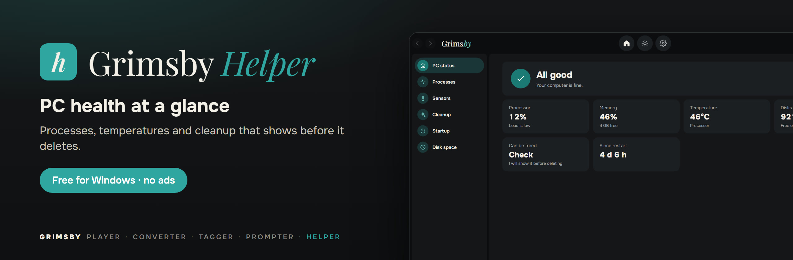
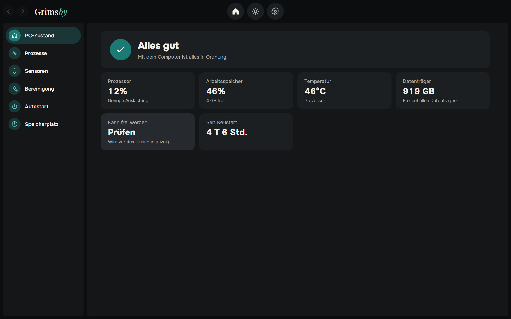
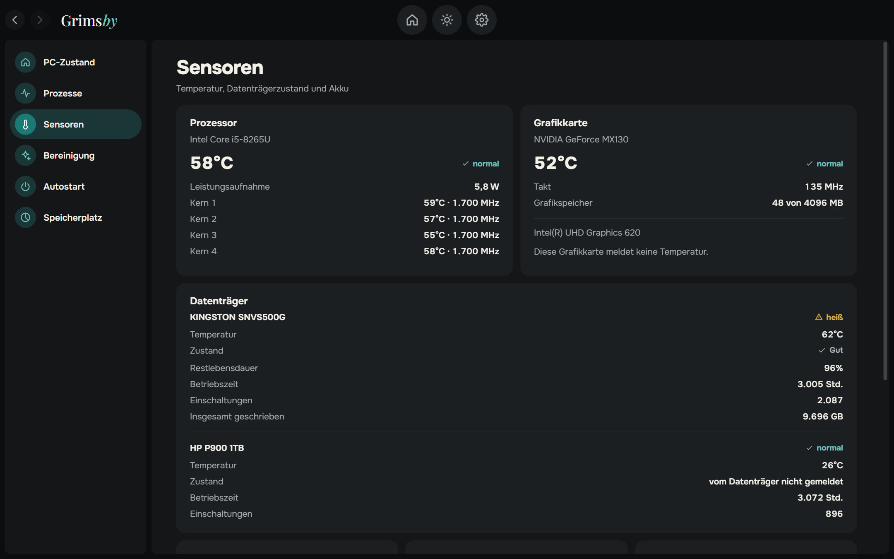
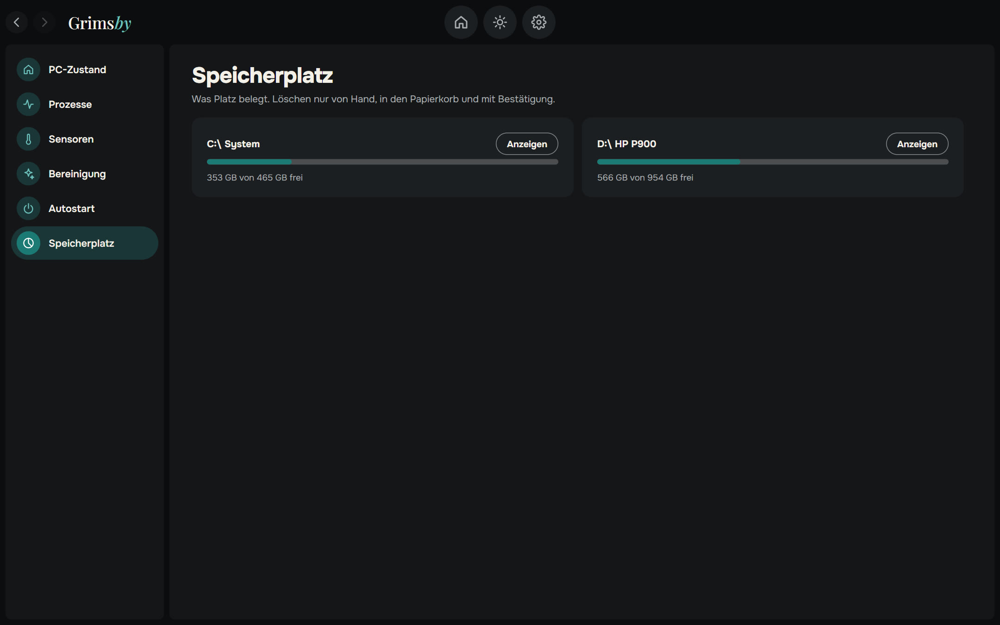
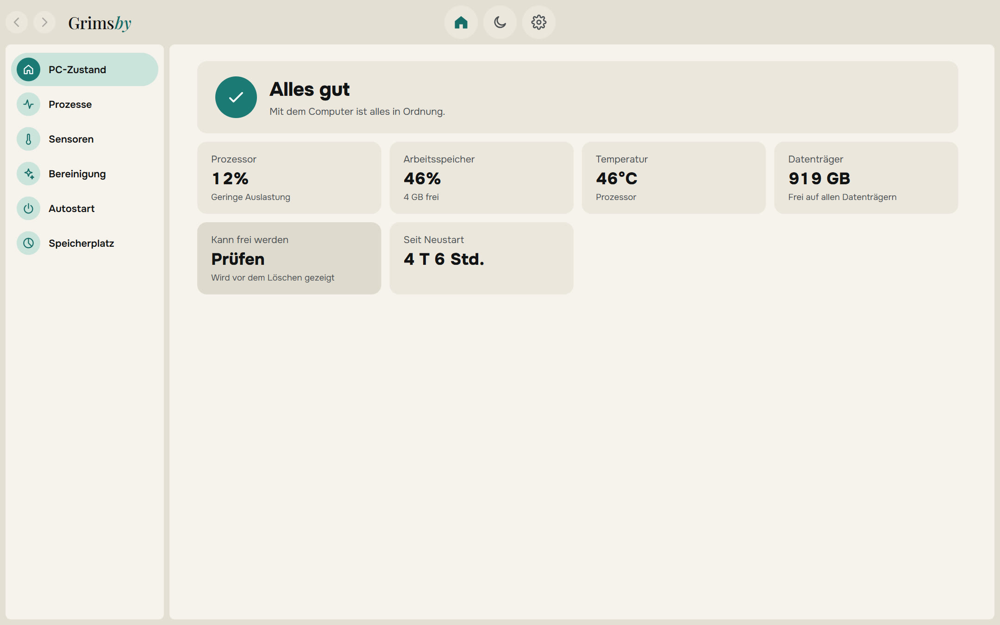

  <a href="README.md">English</a> ·
  <a href="README.ru.md">Русский</a> ·
  <a href="README.es.md">Español</a> ·
  <a href="README.pt.md">Português</a> ·
  <b>Deutsch</b> ·
  <a href="README.fr.md">Français</a> ·
  <a href="README.zh.md">中文</a> ·
  <a href="README.ja.md">日本語</a> ·
  <a href="README.ko.md">한국어</a>

  

  <b>Der Zustand deines PCs – auf einen Blick.</b> 
  Was den Computer auslastet, wie heiß er wird und wie viel Platz du freigeben kannst. Nichts wird gelöscht, bevor du den Knopf drückst.

  
  
  
  
  

  <a href="https://github.com/maksimkhatskevich/grimsby-helper/releases/latest"><b>⬇ Für Windows herunterladen</b></a>
  &nbsp;·&nbsp;
  <a href="#funktionen">Funktionen</a>
  &nbsp;·&nbsp;
  <a href="#datenschutz">Datenschutz</a>
  &nbsp;·&nbsp;
  <a href="#feedback">Feedback</a>

---

## Warum Grimsby Helper

PC-Tools zeigen meist entweder eine Wand aus Zahlen oder versprechen, Windows mit einem Zauberknopf zu „beschleunigen“. Beides sagt dir nicht einfach, ob alles in Ordnung ist.

**Grimsby Helper antwortet einfach.** Die Startseite sagt „Alles gut“, „Einen Blick wert“ oder „Es gibt ein Problem“, erklärt den Grund in klaren Worten und zeigt, was zu tun ist.

---

## Funktionen

### 🩺 PC-Zustand auf einen Blick

Eine Bewertung mit Gründen und einem Knopf für den nächsten Schritt. Darunter: Prozessor, Arbeitsspeicher, Temperatur, freier Speicher, wie viel sich freigeben lässt und die Zeit seit dem letzten Neustart.

### 📈 Prozesse

Prozesse und Apps mit Last auf Prozessor, Arbeitsspeicher, Datenträger, Netzwerk und Grafikkarte; Sortierung, Suche und Gruppierung nach App. Klare Namen und Symbole, Dateispeicherort und Herausgeber. Diagramme für Prozessor, Arbeitsspeicher, Datenträger, Netzwerk und Grafikkarte. **Beenden** und **Struktur beenden** fragen nach, Systemprozesse sind geschützt.

### 🌡 Sensoren und Datenträgerzustand

Prozessortemperatur pro Kern, Taktfrequenzen und Leistungsaufnahme, Grafikkarten, Datenträger, Lüfter, Mainboard und Akku – alles, was dein PC meldet. Datenträgerzustand: Status, SSD-Verschleiß, Betriebsstunden. Der Verlauf der letzten Stunde, des Tages, der Woche oder des Monats bleibt nur auf deinem Computer. Fehlt ein Sensor, sagt Helper das, statt Nullen zu zeigen.

### 🧹 Bereinigung, die zuerst zeigt

Temporäre Dateien, Browser-Cache, Papierkorb, Miniaturansichten, Reste von Windows-Updates, alte Protokolle und Absturzabbilder. Du siehst alles Gefundene mit Größe und verständlicher Beschreibung, hakst ab, was weg soll, und siehst, wie viel frei wird. Dateien landen wann immer möglich im Papierkorb; wo nicht, sagt Helper es vor dem Klick. Browser-Tabs und Passwörter bleiben unangetastet.

### 🚀 Autostart

Was mit Windows startet: Registry-Einträge, Autostart-Ordner, geplante Aufgaben und Dienste anderer Programme. Einträge deaktivieren und wieder aktivieren; der Herausgeber wird angezeigt, und Einträge von Microsoft und Treibern sind vor versehentlichen Änderungen geschützt.

### 💽 Speicherplatz

Eine anschauliche Karte dessen, was Platz belegt, mit den größten Dateien und Ordnern. Gelöscht wird nur von Hand, in den Papierkorb und mit Bestätigung.

### 🔔 Infobereich und Warnungen

Beim Schließen des Fensters kann Helper im Infobereich bleiben, mit Temperatur und Last im Tooltip des Symbols. Warnungen bei Überhitzung, wenig Speicherplatz, wenig Arbeitsspeicher oder einem Datenträger, dessen Zustand nachlässt – ein Ereignis, eine Benachrichtigung. Der Start mit Windows ist standardmäßig aus.

### 🗑 Programme restlos entfernen

Erst die Deinstallation des Programms selbst, dann die Suche nach Resten – Ordnern und Registrierungsschlüsseln –, die dir vor dem Löschen gezeigt werden, mit Wiederherstellungspunkt.

### 🧰 Werkzeuge

Duplikate, leere Ordner, defekte Verknüpfungen, schnelle Dateisuche, Wiederherstellung gelöschter Dateien, Dateien teilen und zusammenfügen, Schredder und Verschlüsselung mit Passwort. **Datenschutz:** Browserverlauf und zuletzt verwendete Dateien löschen, freien Speicher überschreiben.

### 🛠 Windows-Wartung

Systeminformationen, Datenträgerprüfung, Optimierung, Reparatur von Systemdateien, Wiederherstellungspunkte, Dienste, geplante Aufgaben, Kontextmenü und eine vorsichtige Registrierungsbereinigung. Prozesse sind in Apps, Hintergrund und nicht reagierend unterteilt.

### 🤖 Von selbst – und ein Protokoll

Speicherbereinigung nach Zeitplan, sichere automatische Bereinigung von Temp-Dateien und Cache und das Angebot, eine hängende App zu schließen. Das **Protokoll** zeigt alles, was Helper selbst oder auf deinen Klick getan hat; Systemänderungen lassen sich rückgängig machen.

### 🔐 Administratorrechte

Das Programm selbst läuft ohne Administratorrechte. Zum Lesen der Sensoren sind sie nötig, deshalb erhält ein kleiner separater Agent sie einmalig, mit Bestätigung von Windows. Kerntemperaturen, Lüfter und Mainboard brauchen außerdem einen Sensortreiber: Helper lädt dessen offiziellen Installer nur auf deinen Knopfdruck, prüft die Prüfsumme und installiert ihn mit Bestätigung von Windows. Entfernen kannst du ihn in den Einstellungen. Alles andere funktioniert auch ohne ihn.

### ⚙️ Einstellungen und eigener Look

Die Einstellungen sind in Bereiche gegliedert – Darstellung, Sprache, Updates und die der App selbst – mit einer Suche oben, die nur Treffer zeigt. Design: dunkel, hell oder wie Windows; App-Farbe: zehn fertige oder eine eigene. Der Fensterhintergrund kann eine Farbe, ein Verlauf, ein eigenes Foto oder ein stummes Video sein, mit einstellbarer Abdunklung und Unschärfe.

🌍 **9 Sprachen:** Englisch, Russisch, Spanisch, Portugiesisch, Deutsch, Französisch, Chinesisch, Japanisch und Koreanisch – umschalten in den Einstellungen, sofort wirksam.

Das helle Design ist einen Klick entfernt – der Sonnenknopf oben.

---

## Herunterladen und installieren

1. Öffne die Seite der **[neuesten Version](https://github.com/maksimkhatskevich/grimsby-helper/releases/latest)** und lade das Installationsprogramm `.exe` herunter.
2. Starte es. Windows zeigt eventuell ein blaues Fenster „Der Computer wurde durch Windows geschützt“ – eine normale Warnung für Programme ohne kostenpflichtiges Signaturzertifikat. Klicke auf **Weitere Informationen → Trotzdem ausführen**.
   Das Installationsprogramm wurde bei VirusTotal geprüft: [keiner der 68 Virenscanner schlägt an](https://www.virustotal.com/gui/file/ad42128ab26413ff71df138aab058cc6819f2f707081d396ba444b1f522efc1e) (Version 1.1.0).
3. Öffne Helper – die Startseite zeigt sofort den Zustand deines PCs.

**Voraussetzungen:** Windows 10 oder 11 (64 Bit).

---

## Datenschutz

Grimsby Helper arbeitet auf deinem Computer. Informationen über deinen PC werden nirgendwohin gesendet. Ohne Konto, ohne Werbung, ohne Analyse. Online geht das Programm nur, um nach Updates zu suchen und, wenn du den Knopf drückst, den Sensortreiber zu laden.

---

## Grimsby-Apps

<table>
  <tr>
    <td align="center" width="25%"><a href="https://github.com/maksimkhatskevich/grimsby-releases/blob/main/README.de.md"> <b>Grimsby Player</b></a> Offline-Player für deine heruntergeladene Musik und Videos</td>
    <td align="center" width="25%"><a href="https://github.com/maksimkhatskevich/grimsby-converter/blob/main/README.de.md"> <b>Grimsby Converter</b></a> Videos, Audio, Fotos und Dokumente – offline umwandeln</td>
    <td align="center" width="25%"><a href="https://github.com/maksimkhatskevich/grimsby-tagger/blob/main/README.de.md"> <b>Grimsby Tagger</b></a> Tag-Editor für ganze Alben: Tags, Cover, Dateinamen</td>
    <td align="center" width="25%"><a href="https://github.com/maksimkhatskevich/grimsby-prompter/blob/main/README.de.md"> <b>Grimsby Prompter</b></a> Ein einfacher Teleprompter, der deiner Stimme folgt</td>
  </tr>
  <tr>
    <td align="center" width="25%"> <b>Grimsby Helper</b> </td>
    <td align="center" width="25%"><a href="https://github.com/maksimkhatskevich/grimsby-studio/blob/main/README.de.md"> <b>Grimsby Studio</b></a> Videoeditor mit animierten Musik-Einspielern</td>
    <td align="center" width="25%"><a href="https://github.com/maksimkhatskevich/grimsby-notes/blob/main/README.de.md"> <b>Grimsby Notes</b></a> Aufgaben, Projekte, Notizen und Kalender in einem Fenster</td>
  </tr>
</table>

---

## Feedback

Einen Fehler gefunden, eine Idee oder einfach Danke sagen? Schreib mir:

- ✉️ E-Mail: **[grimsbyy@gmail.com](mailto:grimsbyy@gmail.com)**
- 🐞 Fehler und Ideen: [Issues](https://github.com/maksimkhatskevich/grimsby-helper/issues)
- 📣 Telegram: [@itsgrimsby](https://t.me/itsgrimsby) (auf Russisch)

---

## Lizenzen

Grimsby Helper nutzt Open-Source-Komponenten, darunter Electron und React. Die vollständige Liste mit Lizenztexten steht in `THIRD_PARTY_NOTICES.txt` im Programmordner.

© 2026 Grimsby

