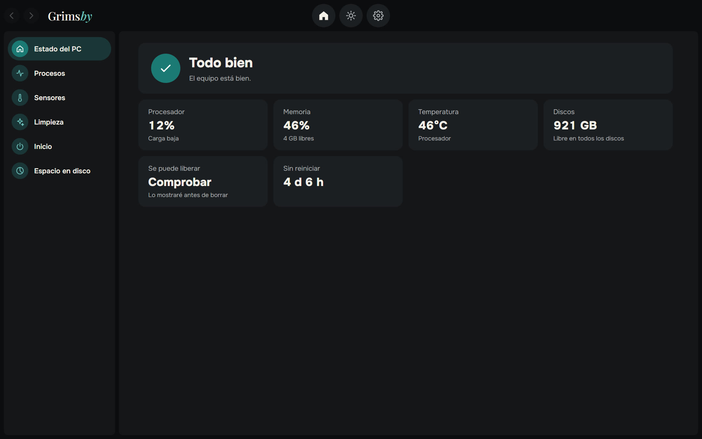
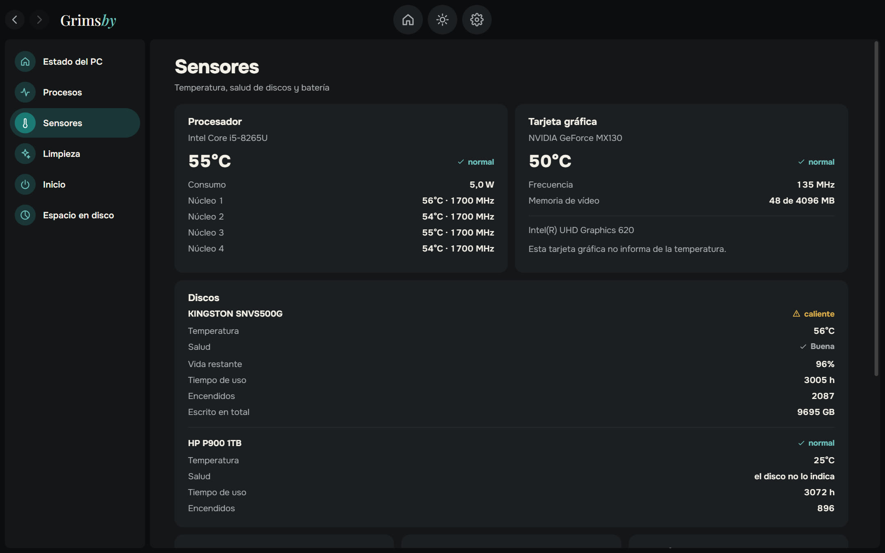
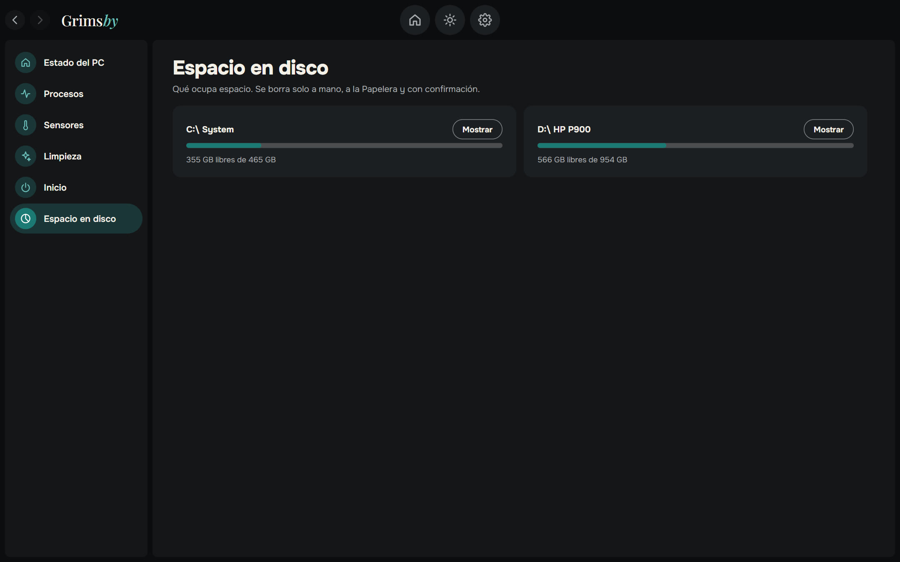
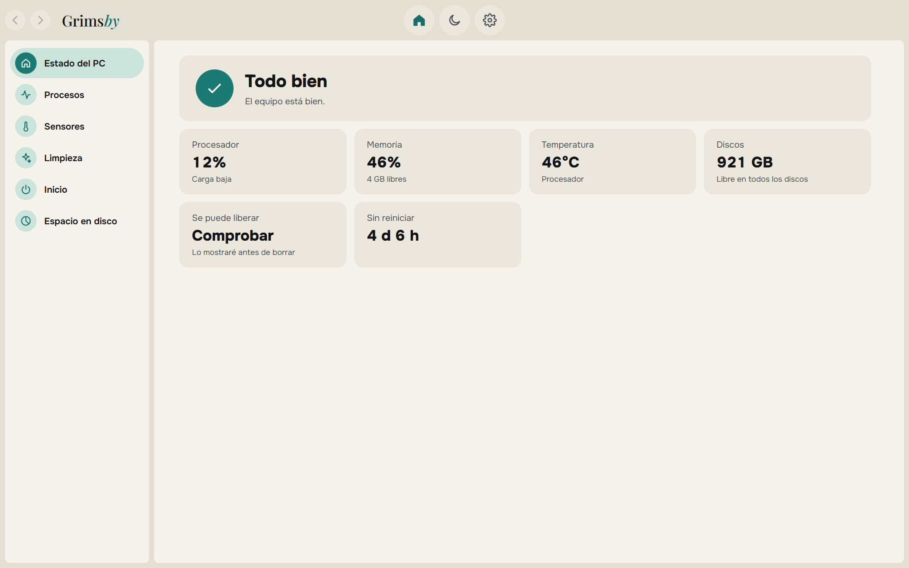

  <a href="README.md">English</a> ·
  <a href="README.ru.md">Русский</a> ·
  <b>Español</b> ·
  <a href="README.pt.md">Português</a> ·
  <a href="README.de.md">Deutsch</a> ·
  <a href="README.fr.md">Français</a> ·
  <a href="README.zh.md">中文</a> ·
  <a href="README.ja.md">日本語</a> ·
  <a href="README.ko.md">한국어</a>

  

  <b>La salud de tu PC, de un vistazo.</b> 
  Qué está cargando el ordenador, cuánto se calienta y cuánto espacio puedes liberar. No se borra nada hasta que pulsas el botón.

  
  
  
  
  

  <a href="https://github.com/maksimkhatskevich/grimsby-helper/releases/latest"><b>⬇ Descargar para Windows</b></a>
  &nbsp;·&nbsp;
  <a href="#funciones">Funciones</a>
  &nbsp;·&nbsp;
  <a href="#privacidad">Privacidad</a>
  &nbsp;·&nbsp;
  <a href="#contacto">Contacto</a>

---

## Por qué Grimsby Helper

Las herramientas para PC suelen mostrar un muro de cifras o prometer que «aceleran» Windows con un botón mágico. Ninguna de las dos cosas te dice claramente si todo va bien.

**Grimsby Helper responde con sencillez.** La pantalla de inicio dice «Todo bien», «Conviene revisarlo» o «Hay un problema», explica el motivo con palabras claras y muestra qué hacer.

---

## Funciones

### 🩺 El estado del PC de un vistazo

Una valoración con motivos y un botón para lo que hay que hacer. Debajo: procesador, memoria, temperatura, espacio libre, cuánto se puede liberar y tiempo desde el último reinicio.

### 📈 Procesos

Procesos y aplicaciones con carga de procesador, memoria, disco, red y gráfica; orden, búsqueda y agrupación por aplicación. Nombres e iconos claros, ubicación del archivo y editor. Gráficos de procesador, memoria, discos, red y gráfica. **Finalizar** y **Finalizar árbol** piden confirmación, y los procesos del sistema están protegidos.

### 🌡 Sensores y salud de los discos

Temperatura del procesador por núcleo, frecuencias y consumo, tarjetas gráficas, discos, ventiladores, placa base y batería: todo lo que tu PC informe. Salud de los discos: estado, desgaste del SSD, horas de uso. El historial de la última hora, día, semana o mes se guarda solo en tu ordenador. Si falta un sensor, Helper lo dice en lugar de mostrar ceros.

### 🧹 Una limpieza que primero muestra

Archivos temporales, caché de navegadores, Papelera, miniaturas, restos de actualizaciones de Windows, registros antiguos y volcados de errores. Ves todo lo encontrado con tamaños y descripciones claras, marcas qué borrar y cuánto se liberará. Siempre que se puede, los archivos van a la Papelera; si no, Helper lo dice antes de pulsar el botón. Las pestañas y contraseñas del navegador nunca se tocan.

### 🚀 Inicio

Lo que arranca con Windows: entradas del registro, carpetas de inicio, tareas programadas y servicios de terceros. Desactiva entradas y vuelve a activarlas; se muestra el editor, y las entradas de Microsoft y de controladores están protegidas contra cambios accidentales.

### 💽 Espacio en disco

Un mapa visual de lo que ocupa espacio, con los archivos y carpetas más grandes. El borrado es solo manual, a la Papelera y con confirmación.

### 🔔 Bandeja y avisos

Al cerrar la ventana, Helper puede quedarse en la bandeja, con la temperatura y la carga en la información del icono. Avisos de sobrecalentamiento, poco espacio, poca memoria o un disco que pierde salud: un suceso, una notificación. El inicio con Windows está desactivado por defecto.

### 🗑 Desinstalación completa

Primero el desinstalador del programa y después la búsqueda de restos —carpetas y claves del registro— que se te muestran antes de borrar nada, con un punto de restauración.

### 🧰 Herramientas

Duplicados, carpetas vacías, accesos directos rotos, búsqueda rápida de archivos, recuperación de archivos borrados, dividir y unir archivos, trituradora y cifrado con contraseña. **Privacidad:** borra el historial de los navegadores y los archivos recientes, limpia el espacio libre.

### 🛠 Mantenimiento de Windows

Información del sistema, comprobación del disco, optimización, reparación de archivos del sistema, puntos de restauración, servicios, tareas programadas, menú contextual y una limpieza prudente del registro. Los procesos se dividen en apps, en segundo plano y que no responden.

### 🤖 Por su cuenta, y un registro

Limpieza de memoria programada, limpieza automática y segura de temporales y caché, y la propuesta de cerrar una app que no responde. El **Registro** guarda todo lo que Helper hizo por sí mismo o con tu clic, y los cambios del sistema se pueden deshacer.

### 🔐 Permisos de administrador

La aplicación funciona sin permisos de administrador. Para leer los sensores sí hacen falta, así que un pequeño agente aparte los obtiene una vez, con la confirmación de Windows. Las temperaturas de los núcleos, los ventiladores y la placa base necesitan además un controlador de sensores: Helper descarga su instalador oficial solo cuando pulsas el botón, comprueba su suma de verificación y lo instala con la confirmación de Windows. Puedes quitarlo en Ajustes. Todo lo demás funciona sin él.

### ⚙️ Ajustes y aspecto propio

Los ajustes están divididos en secciones —Apariencia, Idioma, Actualizaciones y las propias de la app— con un buscador arriba que muestra solo lo que coincide. Tema oscuro, claro o como en Windows; color de la app: diez listos o el tuyo. El fondo de la ventana puede ser un color, un degradado, tu propia foto o un vídeo sin sonido, con oscurecimiento y desenfoque ajustables.

🌍 **9 idiomas:** inglés, ruso, español, portugués, alemán, francés, chino, japonés y coreano; se cambian en Ajustes al instante.

El tema claro está a un clic: el botón del sol, arriba.

---

## Descargar e instalar

1. Abre la página de la **[última versión](https://github.com/maksimkhatskevich/grimsby-helper/releases/latest)** y descarga el instalador `.exe`.
2. Ejecútalo. Windows puede mostrar una ventana azul «Windows protegió su PC»: es un aviso normal para programas sin certificado de firma de pago. Pulsa **Más información → Ejecutar de todas formas**.
   El instalador se ha analizado en VirusTotal: [ninguno de 68 antivirus detecta nada](https://www.virustotal.com/gui/file/ad42128ab26413ff71df138aab058cc6819f2f707081d396ba444b1f522efc1e) (versión 1.1.0).
3. Abre Helper: la pantalla de inicio muestra al instante el estado de tu PC.

**Requisitos:** Windows 10 u 11 (64 bits).

---

## Privacidad

Grimsby Helper funciona en tu ordenador. La información de tu PC nunca se envía a ningún sitio. Sin cuentas, sin anuncios, sin analíticas. La aplicación solo se conecta para buscar actualizaciones y, si pulsas el botón, para descargar el controlador de sensores.

---

## Las apps de Grimsby

<table>
  <tr>
    <td align="center" width="25%"><a href="https://github.com/maksimkhatskevich/grimsby-releases/blob/main/README.es.md"> <b>Grimsby Player</b></a> Reproductor sin conexión para tu música y videos descargados</td>
    <td align="center" width="25%"><a href="https://github.com/maksimkhatskevich/grimsby-converter/blob/main/README.es.md"> <b>Grimsby Converter</b></a> Video, audio, fotos y documentos, convertidos sin conexión</td>
    <td align="center" width="25%"><a href="https://github.com/maksimkhatskevich/grimsby-tagger/blob/main/README.es.md"> <b>Grimsby Tagger</b></a> Editor de etiquetas por lotes: álbumes, portadas, nombres de archivo</td>
    <td align="center" width="25%"><a href="https://github.com/maksimkhatskevich/grimsby-prompter/blob/main/README.es.md"> <b>Grimsby Prompter</b></a> Un teleprompter sencillo que sigue tu voz</td>
  </tr>
  <tr>
    <td align="center" width="25%"> <b>Grimsby Helper</b> </td>
    <td align="center" width="25%"><a href="https://github.com/maksimkhatskevich/grimsby-studio/blob/main/README.es.md"> <b>Grimsby Studio</b></a> Editor de video con insertos musicales animados</td>
    <td align="center" width="25%"><a href="https://github.com/maksimkhatskevich/grimsby-notes/blob/main/README.es.md"> <b>Grimsby Notes</b></a> Tareas, proyectos, notas y calendario en una ventana</td>
  </tr>
</table>

---

## Contacto

¿Encontraste un error, tienes una idea o solo quieres dar las gracias? Escríbeme:

- ✉️ correo: **[grimsbyy@gmail.com](mailto:grimsbyy@gmail.com)**
- 🐞 errores e ideas: [Issues](https://github.com/maksimkhatskevich/grimsby-helper/issues)
- 📣 Telegram: [@itsgrimsby](https://t.me/itsgrimsby) (en ruso)

---

## Licencias

Grimsby Helper usa componentes de código abierto, entre ellos Electron y React. La lista completa con los textos de las licencias está en `THIRD_PARTY_NOTICES.txt`, en la carpeta del programa.

© 2026 Grimsby

