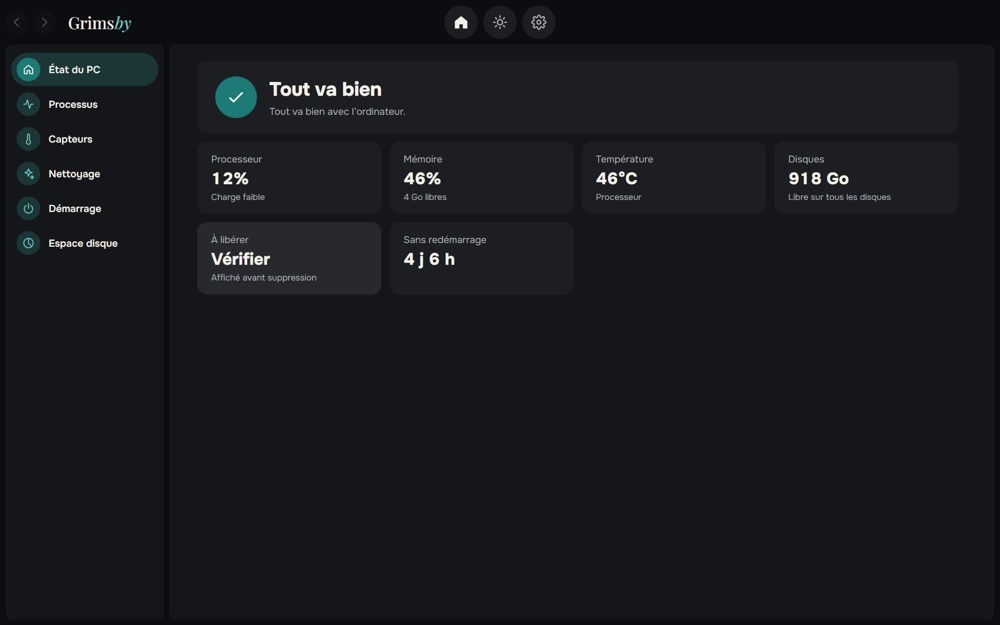
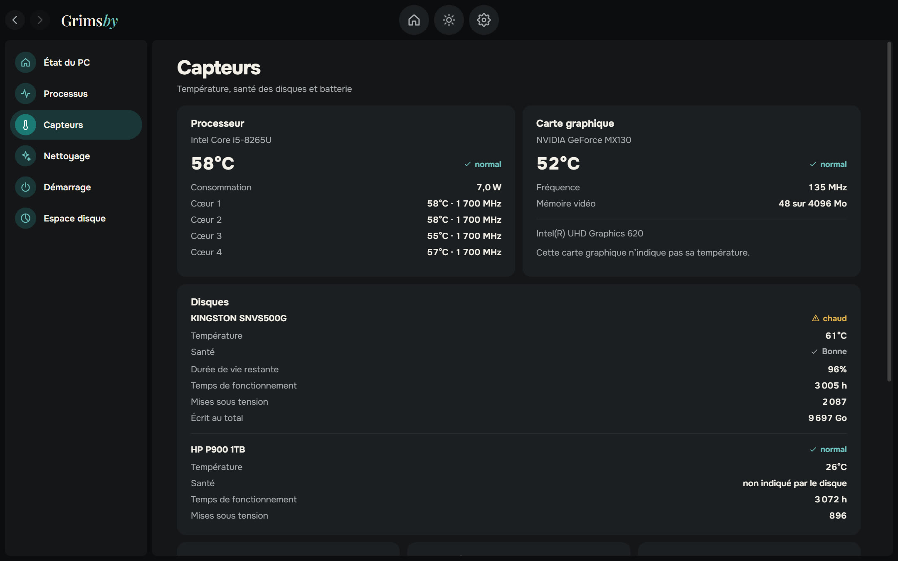
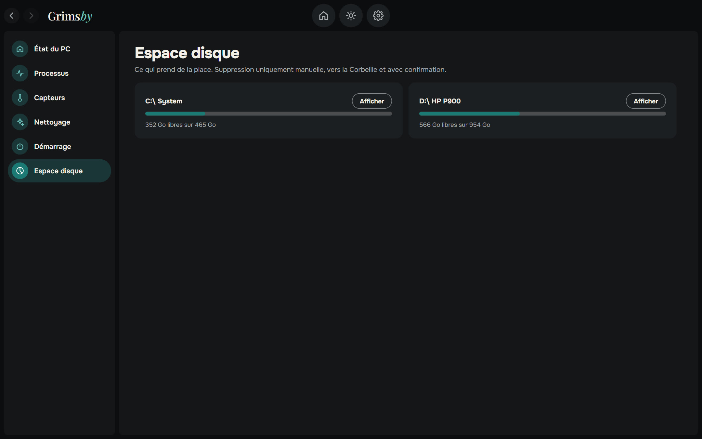
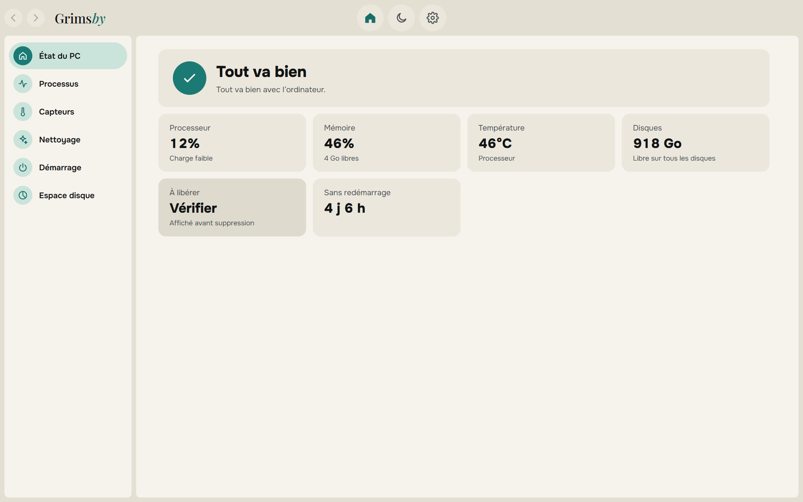

  <a href="README.md">English</a> ·
  <a href="README.ru.md">Русский</a> ·
  <a href="README.es.md">Español</a> ·
  <a href="README.pt.md">Português</a> ·
  <a href="README.de.md">Deutsch</a> ·
  <b>Français</b> ·
  <a href="README.zh.md">中文</a> ·
  <a href="README.ja.md">日本語</a> ·
  <a href="README.ko.md">한국어</a>

  

  <b>La santé de votre PC, en un coup d’œil.</b> 
  Ce qui charge l’ordinateur, à quel point il chauffe et combien d’espace vous pouvez libérer. Rien n’est supprimé tant que vous n’appuyez pas sur le bouton.

  
  
  
  
  

  <a href="https://github.com/maksimkhatskevich/grimsby-helper/releases/latest"><b>⬇ Télécharger pour Windows</b></a>
  &nbsp;·&nbsp;
  <a href="#fonctionnalités">Fonctionnalités</a>
  &nbsp;·&nbsp;
  <a href="#confidentialité">Confidentialité</a>
  &nbsp;·&nbsp;
  <a href="#contact">Contact</a>

---

## Pourquoi Grimsby Helper

Les outils pour PC affichent souvent un mur de chiffres ou promettent « d’accélérer » Windows d’un bouton magique. Ni l’un ni l’autre ne vous dit simplement si tout va bien.

**Grimsby Helper répond simplement.** L’écran d’accueil indique « Tout va bien », « À surveiller » ou « Il y a un problème », explique pourquoi en termes clairs et montre quoi faire.

---

## Fonctionnalités

### 🩺 L’état du PC en un coup d’œil

Un avis avec ses raisons et un bouton pour agir. En dessous : processeur, mémoire, température, espace libre, ce qui peut être libéré et le temps depuis le dernier redémarrage.

### 📈 Processus

Processus et applications avec la charge du processeur, de la mémoire, du disque, du réseau et de la carte graphique ; tri, recherche et regroupement par application. Noms et icônes clairs, emplacement du fichier et éditeur. Graphiques du processeur, de la mémoire, des disques, du réseau et de la carte graphique. **Terminer** et **Terminer l’arborescence** demandent confirmation, et les processus système sont protégés.

### 🌡 Capteurs et santé des disques

Température du processeur par cœur, fréquences et consommation, cartes graphiques, disques, ventilateurs, carte mère et batterie — tout ce que votre PC communique. Santé des disques : état, usure du SSD, heures de fonctionnement. L’historique de la dernière heure, du jour, de la semaine ou du mois reste uniquement sur votre ordinateur. S’il manque un capteur, Helper le dit au lieu d’afficher des zéros.

### 🧹 Un nettoyage qui montre d’abord

Fichiers temporaires, cache des navigateurs, Corbeille, miniatures, restes des mises à jour Windows, anciens journaux et vidages d’erreurs. Vous voyez tout ce qui a été trouvé, avec tailles et descriptions claires, cochez ce qu’il faut supprimer et voyez combien sera libéré. Les fichiers vont dans la Corbeille dès que possible ; sinon, Helper le dit avant le clic. Les onglets et mots de passe du navigateur ne sont jamais touchés.

### 🚀 Démarrage

Ce qui démarre avec Windows : entrées du registre, dossiers de démarrage, tâches planifiées et services d’autres programmes. Désactivez des entrées et réactivez-les ; l’éditeur est affiché, et les entrées de Microsoft et des pilotes sont protégées contre les modifications accidentelles.

### 💽 Espace disque

Une carte visuelle de ce qui occupe l’espace, avec les plus gros fichiers et dossiers. La suppression est uniquement manuelle, vers la Corbeille, avec confirmation.

### 🔔 Zone de notification et alertes

En fermant la fenêtre, Helper peut rester dans la zone de notification, avec la température et la charge dans l’info-bulle de l’icône. Alertes en cas de surchauffe, de manque d’espace ou de mémoire, ou d’un disque dont la santé se dégrade — un événement, une notification. Le lancement avec Windows est désactivé par défaut.

### 🗑 Désinstallation complète

D’abord le désinstalleur du programme, puis la recherche des restes — dossiers et clés de registre — affichés avant toute suppression, avec un point de restauration.

### 🧰 Outils

Doublons, dossiers vides, raccourcis cassés, recherche rapide de fichiers, récupération de fichiers supprimés, découpage et assemblage, broyeur et chiffrement par mot de passe. **Confidentialité :** effacer l’historique des navigateurs et les fichiers récents, nettoyer l’espace libre.

### 🛠 Entretien de Windows

Informations système, vérification du disque, optimisation, réparation des fichiers système, points de restauration, services, tâches planifiées, menu contextuel et un nettoyage prudent du registre. Les processus sont répartis entre applications, arrière-plan et sans réponse.

### 🤖 En autonomie, et un journal

Nettoyage de la mémoire planifié, nettoyage automatique et sûr des fichiers temporaires et du cache, et proposition de fermer une application qui ne répond plus. Le **Journal** liste tout ce que Helper a fait seul ou sur votre clic, et les modifications du système peuvent être annulées.

### 🔐 Droits d’administrateur

L’application elle-même fonctionne sans droits d’administrateur. Ils sont nécessaires pour lire les capteurs : un petit agent séparé les obtient une seule fois, avec la confirmation de Windows. Les températures des cœurs, les ventilateurs et la carte mère demandent aussi un pilote de capteurs : Helper télécharge son installateur officiel uniquement quand vous appuyez sur le bouton, vérifie sa somme de contrôle et l’installe avec la confirmation de Windows. Vous pouvez le supprimer dans les Réglages. Tout le reste fonctionne sans lui.

### ⚙️ Réglages et apparence personnalisée

Les réglages sont répartis en sections — Apparence, Langue, Mises à jour et celles de l’application — avec une recherche en haut qui n’affiche que ce qui correspond. Thème sombre, clair ou comme Windows ; couleur de l’application : dix au choix ou la vôtre. Le fond de la fenêtre peut être une couleur, un dégradé, votre propre photo ou une vidéo muette, avec assombrissement et flou réglables.

🌍 **9 langues :** anglais, russe, espagnol, portugais, allemand, français, chinois, japonais et coréen — à changer dans les Réglages, effet immédiat.

Le thème clair est à un clic — le bouton soleil en haut.

---

## Télécharger et installer

1. Ouvrez la page de la **[dernière version](https://github.com/maksimkhatskevich/grimsby-helper/releases/latest)** et téléchargez l’installeur `.exe`.
2. Lancez-le. Windows peut afficher une fenêtre bleue « Windows a protégé votre ordinateur » : c’est un avertissement normal pour les logiciels sans certificat de signature payant. Cliquez sur **Informations complémentaires → Exécuter quand même**.
   L’installeur a été vérifié sur VirusTotal : [aucun des 68 antivirus ne détecte quoi que ce soit](https://www.virustotal.com/gui/file/ad42128ab26413ff71df138aab058cc6819f2f707081d396ba444b1f522efc1e) (version 1.1.0).
3. Ouvrez Helper : l’écran d’accueil montre tout de suite l’état de votre PC.

**Configuration requise :** Windows 10 ou 11 (64 bits).

---

## Confidentialité

Grimsby Helper fonctionne sur votre ordinateur. Les informations sur votre PC ne sont jamais envoyées. Sans compte, sans publicité, sans statistiques. L’application ne se connecte que pour vérifier les mises à jour et, si vous appuyez sur le bouton, télécharger le pilote de capteurs.

---

## Les applis Grimsby

<table>
  <tr>
    <td align="center" width="25%"><a href="https://github.com/maksimkhatskevich/grimsby-releases/blob/main/README.fr.md"> <b>Grimsby Player</b></a> Lecteur hors ligne pour votre musique et vos clips téléchargés</td>
    <td align="center" width="25%"><a href="https://github.com/maksimkhatskevich/grimsby-converter/blob/main/README.fr.md"> <b>Grimsby Converter</b></a> Vidéo, audio, photos et documents convertis hors ligne</td>
    <td align="center" width="25%"><a href="https://github.com/maksimkhatskevich/grimsby-tagger/blob/main/README.fr.md"> <b>Grimsby Tagger</b></a> Éditeur de tags par lots : albums, pochettes, noms de fichiers</td>
    <td align="center" width="25%"><a href="https://github.com/maksimkhatskevich/grimsby-prompter/blob/main/README.fr.md"> <b>Grimsby Prompter</b></a> Un téléprompteur simple qui suit votre voix</td>
  </tr>
  <tr>
    <td align="center" width="25%"> <b>Grimsby Helper</b> </td>
    <td align="center" width="25%"><a href="https://github.com/maksimkhatskevich/grimsby-studio/blob/main/README.fr.md"> <b>Grimsby Studio</b></a> Éditeur vidéo avec des habillages musicaux animés</td>
    <td align="center" width="25%"><a href="https://github.com/maksimkhatskevich/grimsby-notes/blob/main/README.fr.md"> <b>Grimsby Notes</b></a> Tâches, projets, notes et calendrier dans une seule fenêtre</td>
  </tr>
</table>

---

## Contact

Un bug, une idée ou juste envie de dire merci ? Écrivez-moi :

- ✉️ e-mail: **[grimsbyy@gmail.com](mailto:grimsbyy@gmail.com)**
- 🐞 bugs et idées: [Issues](https://github.com/maksimkhatskevich/grimsby-helper/issues)
- 📣 Telegram : [@itsgrimsby](https://t.me/itsgrimsby) (en russe)

---

## Licences

Grimsby Helper utilise des composants open source, dont Electron et React. La liste complète avec les textes des licences se trouve dans `THIRD_PARTY_NOTICES.txt`, dans le dossier du programme.

© 2026 Grimsby

