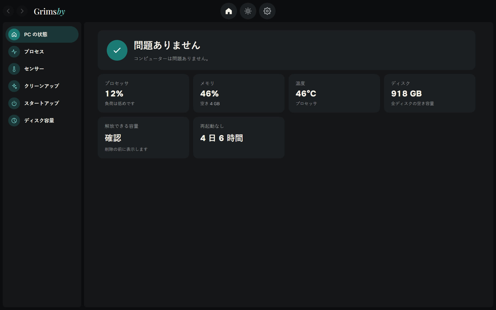
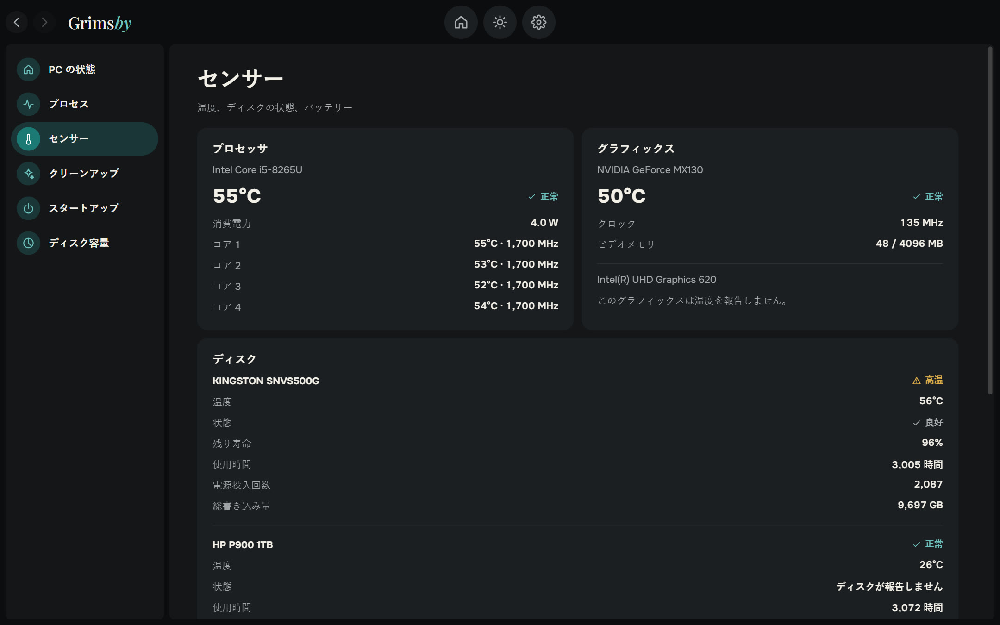
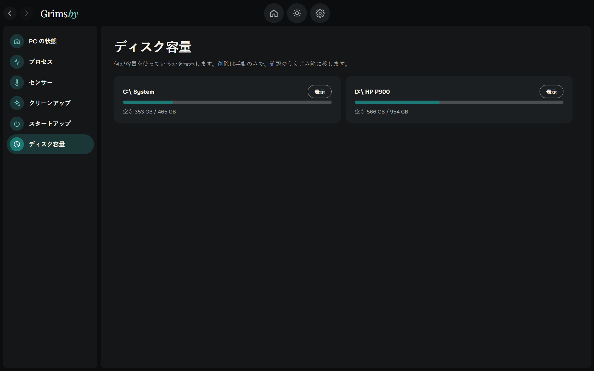
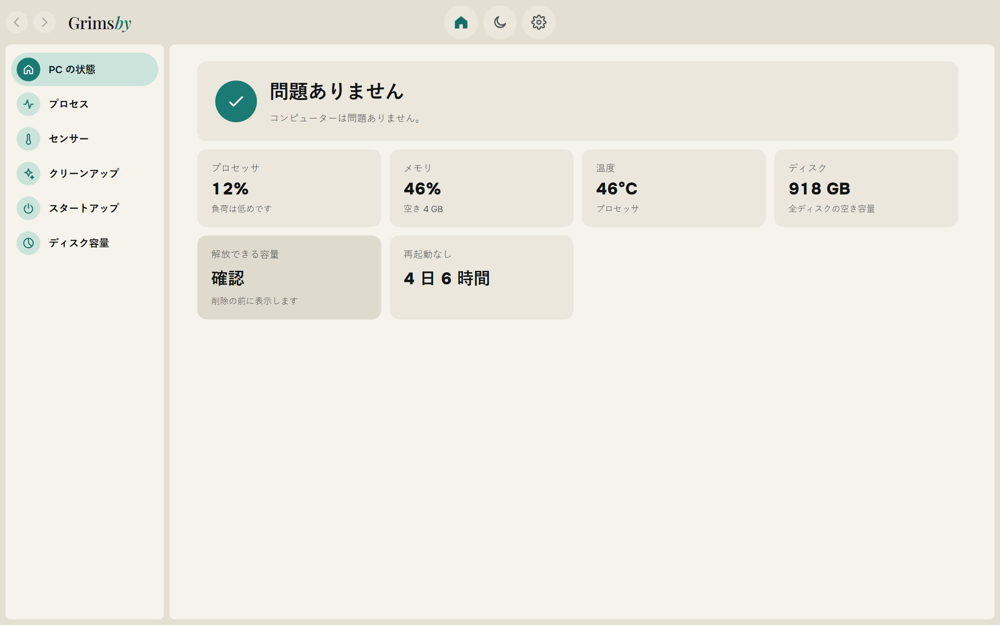

  <a href="README.md">English</a> ·
  <a href="README.ru.md">Русский</a> ·
  <a href="README.es.md">Español</a> ·
  <a href="README.pt.md">Português</a> ·
  <a href="README.de.md">Deutsch</a> ·
  <a href="README.fr.md">Français</a> ·
  <a href="README.zh.md">中文</a> ·
  <b>日本語</b> ·
  <a href="README.ko.md">한국어</a>

  

  <b>PC の健康状態が、ひと目でわかる。</b> 
  何がパソコンに負荷をかけているか、どれくらい熱いか、どれだけ空き容量を増やせるか。ボタンを押すまで何も削除しません。

  
  
  
  

  <a href="https://github.com/maksimkhatskevich/grimsby-helper/releases/latest"><b>⬇ Windows 版をダウンロード</b></a>
  &nbsp;·&nbsp;
  <a href="#機能">機能</a>
  &nbsp;·&nbsp;
  <a href="#プライバシー">プライバシー</a>
  &nbsp;·&nbsp;
  <a href="#お問い合わせ">お問い合わせ</a>

---

## Grimsby Helper を選ぶ理由

PC 向けツールの多くは、数字をずらりと並べるか、魔法のボタンひとつで Windows を「高速化」すると約束するかのどちらかです。どちらも、問題がないかどうかをはっきりとは教えてくれません。

**Grimsby Helper はシンプルに答えます。** ホーム画面に「問題ありません」「確認をおすすめします」「問題があります」のどれかを表示し、理由をわかりやすく説明して、やるべきことを示します。

---

## 機能

### 🩺 PC の状態がひと目で

理由つきの判定と、やるべきことのボタン。その下にプロセッサー、メモリ、温度、空き容量、増やせる容量、前回の再起動からの時間。

### 📈 プロセス

プロセスとアプリのプロセッサー、メモリ、ディスク、ネットワーク、GPU の使用状況。並べ替え、検索、アプリごとのグループ化。わかりやすい名前とアイコン、ファイルの場所と発行元。プロセッサー、メモリ、ディスク、ネットワーク、GPU のグラフ。**終了** と **ツリーを終了** は確認を求め、システムのプロセスは保護されています。

### 🌡 センサーとディスクの健康

コアごとのプロセッサー温度、クロックと消費電力、グラフィックカード、ディスク、ファン、マザーボード、バッテリー。PC が報告するものすべて。ディスクの健康：状態、SSD の消耗、使用時間。過去 1 時間・1 日・1 週間・1 か月の履歴はパソコンの中にだけ保存されます。センサーがない場合は、ゼロを表示せずにそう伝えます。

### 🧹 まず見せるクリーンアップ

一時ファイル、ブラウザーのキャッシュ、ごみ箱、サムネイル、Windows Update の残り、古いログ、クラッシュダンプ。見つかったものをサイズとわかりやすい説明付きですべて表示し、削除するものにチェックを入れると、空く容量がわかります。可能な限りファイルはごみ箱へ移動し、できない場合はボタンを押す前に知らせます。ブラウザーのタブやパスワードには一切触れず、レジストリのクリーンアップもありません。

### 🚀 スタートアップ

Windows と一緒に起動するもの：レジストリ、スタートアップフォルダー、タスク スケジューラ、他社製サービス。無効にしたり元に戻したりできます。発行元が表示され、Microsoft とドライバーの項目は誤って変更しないよう保護されています。

### 💽 ディスク容量

何が容量を使っているかを示すマップと、最も大きいファイルとフォルダー。削除は手動のみで、ごみ箱へ、確認付きです。

### 🔔 トレイと通知

ウィンドウを閉じてもトレイに残せます。アイコンのヒントに温度と負荷を表示。過熱、空き容量不足、メモリ不足、ディスクの劣化を通知します。ひとつの出来事にひとつの通知。Windows と同時の起動は初期設定でオフです。

### 🔐 管理者権限

アプリ自体は管理者権限なしで動きます。センサーを読むには権限が必要なため、小さな別のエージェントが Windows の確認のうえで一度だけ権限を得ます。コア温度、ファン、マザーボードにはセンサードライバーも必要です。ボタンを押したときだけ公式インストーラーをダウンロードし、チェックサムを確認して、Windows の確認のうえでインストールします。設定から削除できます。それ以外の機能はドライバーなしで動きます。

🌍 **9 言語：** 英語、ロシア語、スペイン語、ポルトガル語、ドイツ語、フランス語、中国語、日本語、韓国語。設定で切り替えるとすぐに反映されます。

ライトテーマもワンクリック。上の太陽ボタンです。

---

## ダウンロードとインストール

1. **[最新バージョン](https://github.com/maksimkhatskevich/grimsby-helper/releases/latest)** のページを開き、インストーラー `.exe` をダウンロードします。
2. 実行します。Windows に青い「Windows によって PC が保護されました」画面が出ることがありますが、有料の署名証明書がないアプリでは普通の警告です。**詳細情報 → 実行** をクリックしてください。
3. Helper を開くと、ホーム画面にすぐ PC の状態が表示されます。

**動作環境：** Windows 10 / 11（64 ビット）。

---

## プライバシー

Grimsby Helper はあなたのパソコンの中で動きます。PC の情報はどこにも送信されません。アカウントも広告も分析もありません。インターネットにつなぐのは、アップデートの確認と、ボタンを押したときのセンサードライバーのダウンロードだけです。

---

## Grimsby のアプリ

<table>
  <tr>
    <td align="center" width="20%"><a href="https://github.com/maksimkhatskevich/grimsby-releases/blob/main/README.ja.md"> <b>Grimsby Player</b></a> ダウンロードした音楽と MV のためのオフラインプレーヤー</td>
    <td align="center" width="20%"><a href="https://github.com/maksimkhatskevich/grimsby-converter/blob/main/README.ja.md"> <b>Grimsby Converter</b></a> 動画・音声・写真・文書をオフラインで変換</td>
    <td align="center" width="20%"><a href="https://github.com/maksimkhatskevich/grimsby-tagger/blob/main/README.ja.md"> <b>Grimsby Tagger</b></a> タグ一括編集：アルバム、カバー、ファイル名</td>
    <td align="center" width="20%"><a href="https://github.com/maksimkhatskevich/grimsby-prompter/blob/main/README.ja.md"> <b>Grimsby Prompter</b></a> 声についてくる、シンプルなプロンプター</td>
    <td align="center" width="20%"> <b>Grimsby Helper</b> </td>
  </tr>
</table>

---

## お問い合わせ

不具合を見つけた、アイデアがある、またはお礼を伝えたい？ご連絡ください：

- ✉️ メール: **[grimsbyy@gmail.com](mailto:grimsbyy@gmail.com)**
- 🐞 不具合とアイデア: [Issues](https://github.com/maksimkhatskevich/grimsby-helper/issues)
- 📣 Telegram：[@itsgrimsby](https://t.me/itsgrimsby)（ロシア語）

---

## ライセンス

Grimsby Helper は、Electron や React などのオープンソースコンポーネントを使用しています。ライセンス本文付きの一覧は、プログラムフォルダーの `THIRD_PARTY_NOTICES.txt` にあります。

© 2026 Grimsby

