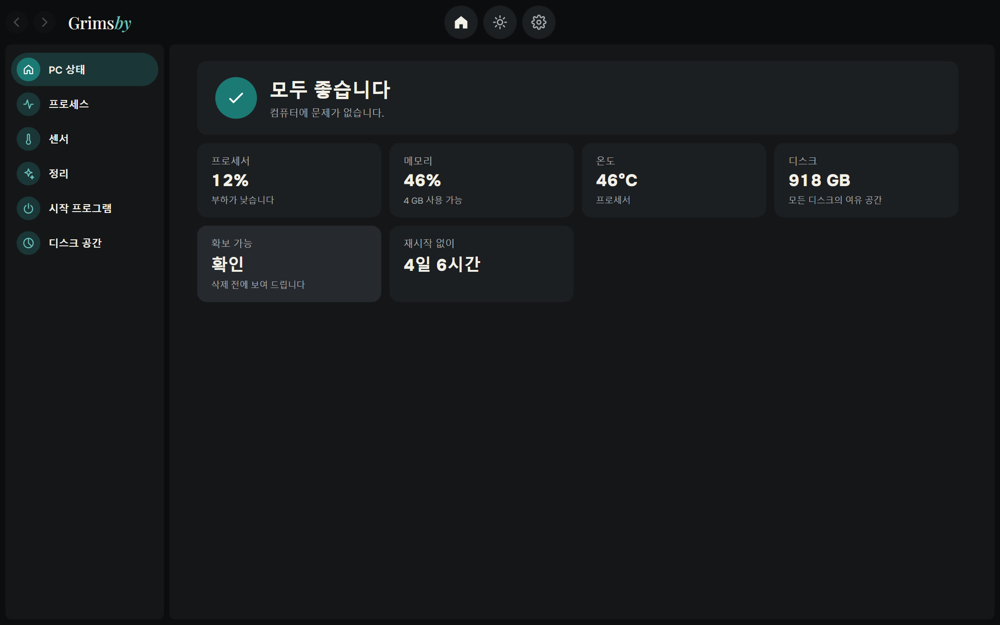
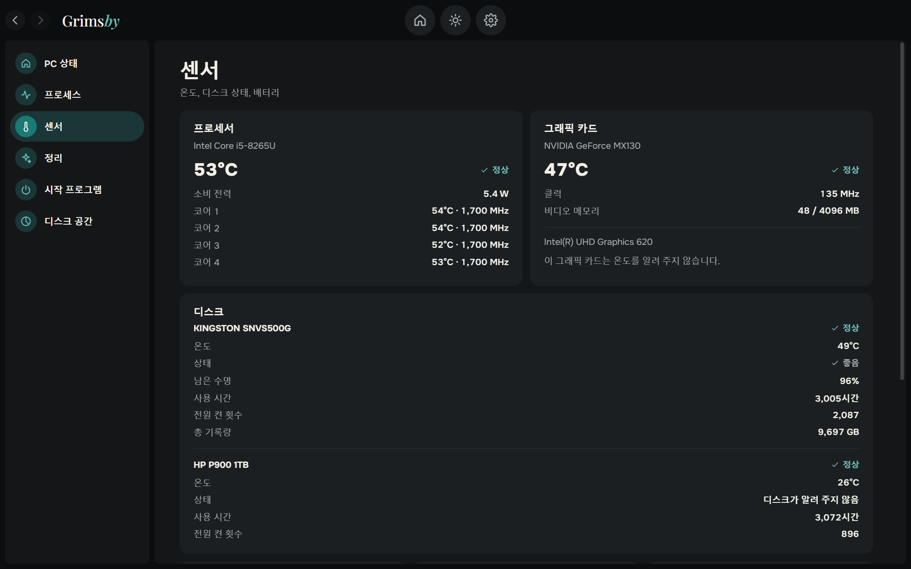
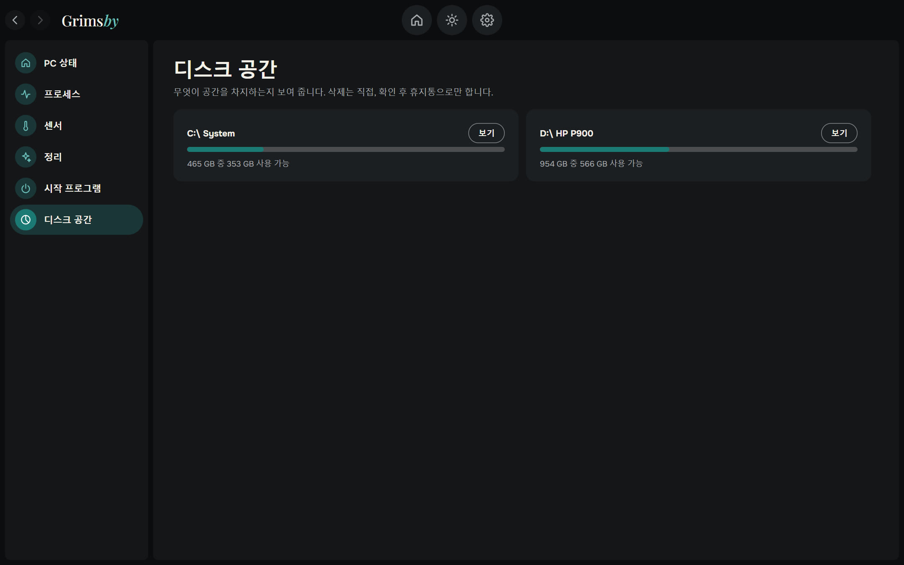
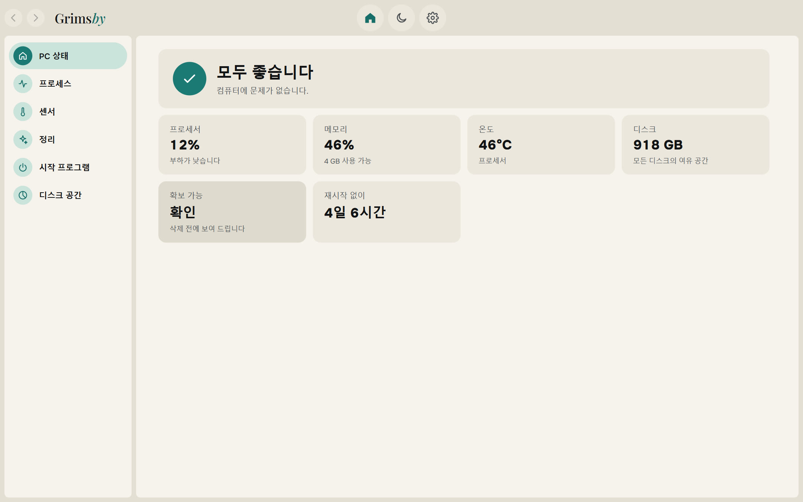

  <a href="README.md">English</a> ·
  <a href="README.ru.md">Русский</a> ·
  <a href="README.es.md">Español</a> ·
  <a href="README.pt.md">Português</a> ·
  <a href="README.de.md">Deutsch</a> ·
  <a href="README.fr.md">Français</a> ·
  <a href="README.zh.md">中文</a> ·
  <a href="README.ja.md">日本語</a> ·
  <b>한국어</b>

  

  <b>PC 상태를 한눈에.</b> 
  무엇이 컴퓨터에 부담을 주는지, 얼마나 뜨거운지, 공간을 얼마나 확보할 수 있는지 보여 줍니다. 버튼을 누르기 전에는 아무것도 지우지 않습니다.

  
  
  
  
  

  <a href="https://github.com/maksimkhatskevich/grimsby-helper/releases/latest"><b>⬇ Windows용 다운로드</b></a>
  &nbsp;·&nbsp;
  <a href="#기능">기능</a>
  &nbsp;·&nbsp;
  <a href="#개인정보">개인정보</a>
  &nbsp;·&nbsp;
  <a href="#문의">문의</a>

---

## 왜 Grimsby Helper인가

PC 도구는 보통 숫자를 잔뜩 늘어놓거나, 마법 버튼 하나로 Windows를 “빠르게” 해 준다고 약속합니다. 어느 쪽도 모든 게 괜찮은지 쉽게 알려 주지 않습니다.

**Grimsby Helper는 간단하게 답합니다.** 홈 화면이 “모두 좋습니다”, “살펴볼 만합니다”, “문제가 있습니다” 중 하나를 보여 주고, 이유를 쉬운 말로 설명하며 해야 할 일을 알려 줍니다.

---

## 기능

### 🩺 PC 상태를 한눈에

이유가 담긴 평가와 해야 할 일을 위한 버튼. 아래에는 프로세서, 메모리, 온도, 남은 공간, 확보할 수 있는 공간, 마지막 재시작 이후 시간이 나옵니다.

### 📈 프로세스

프로세스와 앱의 프로세서, 메모리, 디스크, 네트워크, 그래픽 사용량. 정렬, 검색, 앱별 묶기. 알아보기 쉬운 이름과 아이콘, 파일 위치와 게시자. 프로세서, 메모리, 디스크, 네트워크, 그래픽 그래프. **종료** 와 **트리 종료** 는 확인을 받고, 시스템 프로세스는 보호됩니다.

### 🌡 센서와 디스크 상태

코어별 프로세서 온도, 클럭과 전력 소비, 그래픽카드, 디스크, 팬, 메인보드, 배터리 — PC가 알려 주는 모든 것. 디스크 상태: 건강 상태, SSD 마모, 사용 시간. 최근 1시간·하루·일주일·한 달의 기록은 내 컴퓨터에만 저장됩니다. 센서가 없으면 0을 보여 주는 대신 없다고 알려 줍니다.

### 🧹 먼저 보여 주는 정리

임시 파일, 브라우저 캐시, 휴지통, 미리 보기, Windows 업데이트 잔여물, 오래된 로그, 충돌 덤프. 찾은 항목을 크기와 쉬운 설명과 함께 보고, 지울 것을 고르면 얼마나 비워지는지 알 수 있습니다. 파일은 가능한 한 휴지통으로 가고, 불가능하면 버튼을 누르기 전에 Helper가 알려 줍니다. 브라우저 탭과 비밀번호는 건드리지 않습니다.

### 🚀 시작 프로그램

Windows와 함께 시작되는 것: 레지스트리 항목, 시작 폴더, 예약된 작업, 타사 서비스. 항목을 끄고 다시 켤 수 있습니다. 게시자가 표시되고, Microsoft와 드라이버 항목은 실수로 바뀌지 않게 보호됩니다.

### 💽 디스크 공간

무엇이 공간을 차지하는지 보여 주는 지도와 가장 큰 파일과 폴더. 삭제는 직접만, 휴지통으로, 확인을 거쳐서 합니다.

### 🔔 트레이와 알림

창을 닫아도 Helper를 트레이에 둘 수 있고, 아이콘 툴팁에 온도와 부하가 나옵니다. 과열, 공간 부족, 메모리 부족, 디스크 상태 저하를 알려 줍니다. 한 가지 일에 알림 하나. Windows와 함께 시작은 기본으로 꺼져 있습니다.

### 🗑 흔적까지 제거

먼저 프로그램 자체 제거 도구를 실행하고, 남은 폴더와 레지스트리 키를 찾아 삭제 전에 보여 주며 복원 지점도 만듭니다.

### 🧰 도구

중복 파일, 빈 폴더, 깨진 바로 가기, 빠른 파일 검색, 삭제한 파일 복구, 파일 나누기와 합치기, 파쇄기, 암호 암호화. **개인 정보:** 브라우저 기록과 최근 파일 지우기, 빈 공간 덮어쓰기.

### 🛠 Windows 관리

시스템 정보, 디스크 검사, 최적화, 시스템 파일 복구, 복원 지점, 서비스, 작업 스케줄러, 상황에 맞는 메뉴, 신중한 레지스트리 정리. 프로세스는 앱, 백그라운드, 응답 없음으로 나뉩니다.

### 🤖 알아서 하는 일과 기록

일정에 따른 메모리 정리, 임시 파일과 캐시의 안전한 자동 정리, 응답 없는 앱 닫기 제안. **기록**에는 Helper가 스스로 또는 클릭으로 한 모든 일이 남고, 시스템 변경은 되돌릴 수 있습니다.

### 🔐 관리자 권한

앱 자체는 관리자 권한 없이 동작합니다. 센서를 읽으려면 권한이 필요하므로, 작은 별도 에이전트가 Windows 확인을 거쳐 한 번 권한을 받습니다. 코어 온도, 팬, 메인보드에는 센서 드라이버도 필요합니다. 버튼을 눌렀을 때만 공식 설치 파일을 내려받아 체크섬을 확인하고, Windows 확인을 거쳐 설치합니다. 설정에서 제거할 수 있습니다. 나머지 기능은 드라이버 없이도 동작합니다.

### ⚙️ 설정과 나만의 모양

설정은 모양, 언어, 업데이트와 앱 고유의 섹션으로 나뉘고, 위쪽 검색은 일치하는 항목만 보여 줍니다. 테마는 어둡게, 밝게, Windows 설정에 맞춤 중에서, 앱 색은 준비된 10가지 또는 직접 고른 색으로. 창 배경은 단색, 그라데이션, 내 사진이나 소리 없는 동영상으로 바꿀 수 있고 어둡게 하기와 흐림도 조절됩니다.

🌍 **9개 언어:** 영어, 러시아어, 스페인어, 포르투갈어, 독일어, 프랑스어, 중국어, 일본어, 한국어 — 설정에서 바꾸면 바로 적용됩니다.

라이트 테마도 클릭 한 번, 위쪽의 해 모양 버튼입니다.

---

## 다운로드 및 설치

1. **[최신 버전](https://github.com/maksimkhatskevich/grimsby-helper/releases/latest)** 페이지를 열고 설치 프로그램 `.exe`를 다운로드하세요.
2. 실행하세요. Windows가 파란색 "Windows의 PC 보호" 창을 띄울 수 있는데, 유료 코드 서명 인증서가 없는 프로그램에 대한 일반적인 경고입니다. **추가 정보 → 실행**을 누르세요.
   설치 프로그램은 VirusTotal에서 검사했습니다: [백신 엔진 68개 모두 이상 없음](https://www.virustotal.com/gui/file/ad42128ab26413ff71df138aab058cc6819f2f707081d396ba444b1f522efc1e) (버전 1.1.0).
3. Helper를 열면 홈 화면에 바로 PC 상태가 나옵니다.

**요구 사항:** Windows 10 또는 11(64비트).

---

## 개인정보

Grimsby Helper는 내 컴퓨터에서 동작합니다. PC 정보는 어디로도 전송되지 않습니다. 계정도 광고도 분석도 없습니다. 인터넷에는 업데이트를 확인할 때와, 버튼을 눌러 센서 드라이버를 내려받을 때만 연결합니다.

---

## Grimsby 앱

<table>
  <tr>
    <td align="center" width="25%"><a href="https://github.com/maksimkhatskevich/grimsby-releases/blob/main/README.ko.md"> <b>Grimsby Player</b></a> 다운로드한 음악과 뮤직비디오를 위한 오프라인 플레이어</td>
    <td align="center" width="25%"><a href="https://github.com/maksimkhatskevich/grimsby-converter/blob/main/README.ko.md"> <b>Grimsby Converter</b></a> 영상, 오디오, 사진, 문서를 오프라인으로 변환</td>
    <td align="center" width="25%"><a href="https://github.com/maksimkhatskevich/grimsby-tagger/blob/main/README.ko.md"> <b>Grimsby Tagger</b></a> 태그 일괄 편집: 앨범, 커버, 파일 이름</td>
    <td align="center" width="25%"><a href="https://github.com/maksimkhatskevich/grimsby-prompter/blob/main/README.ko.md"> <b>Grimsby Prompter</b></a> 목소리를 따라가는 간단한 프롬프터</td>
  </tr>
  <tr>
    <td align="center" width="25%"> <b>Grimsby Helper</b> </td>
    <td align="center" width="25%"><a href="https://github.com/maksimkhatskevich/grimsby-studio/blob/main/README.ko.md"> <b>Grimsby Studio</b></a> 애니메이션 음악 인서트를 만드는 동영상 편집기</td>
    <td align="center" width="25%"><a href="https://github.com/maksimkhatskevich/grimsby-notes/blob/main/README.ko.md"> <b>Grimsby Notes</b></a> 할 일, 프로젝트, 노트, 캘린더를 한 창에서</td>
  </tr>
</table>

---

## 문의

버그를 찾았거나, 아이디어가 있거나, 그냥 고맙다고 말하고 싶다면 연락 주세요:

- ✉️ 이메일: **[grimsbyy@gmail.com](mailto:grimsbyy@gmail.com)**
- 🐞 버그와 아이디어: [Issues](https://github.com/maksimkhatskevich/grimsby-helper/issues)
- 📣 Telegram: [@itsgrimsby](https://t.me/itsgrimsby) (러시아어)

---

## 라이선스

Grimsby Helper는 Electron, React 등 오픈 소스 구성 요소를 사용합니다. 라이선스 전문이 포함된 전체 목록은 프로그램 폴더의 `THIRD_PARTY_NOTICES.txt`에 있습니다.

© 2026 Grimsby

