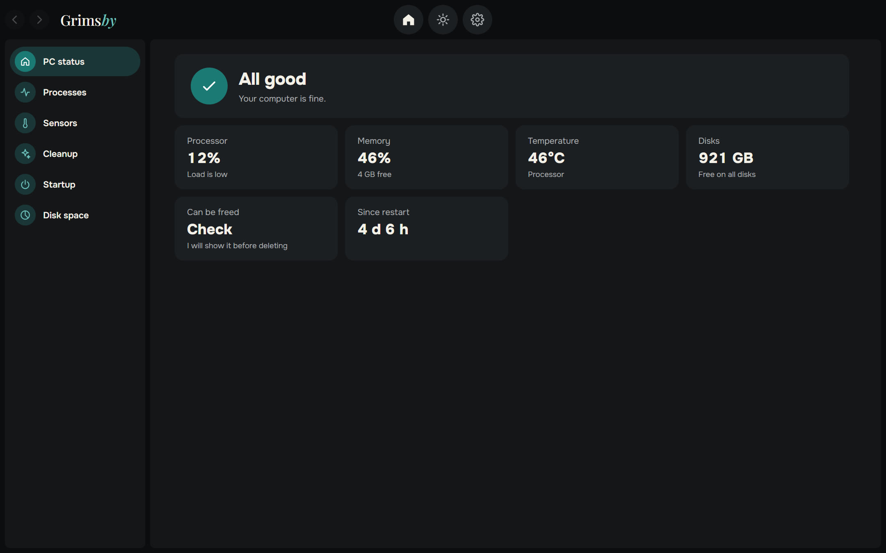
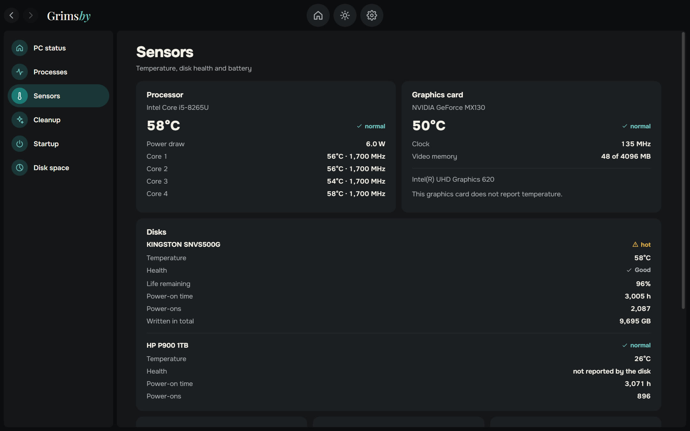
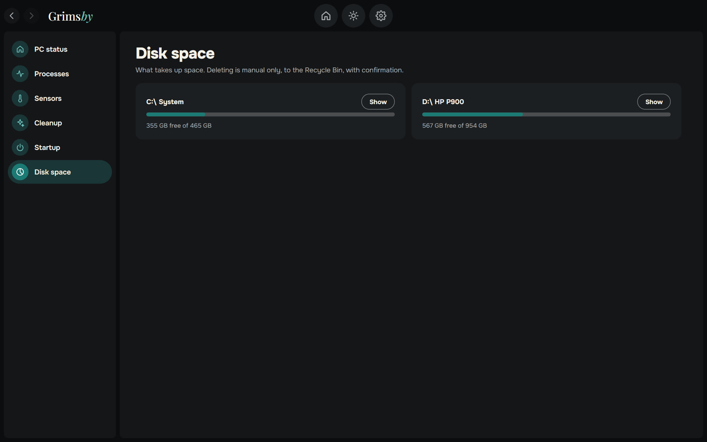
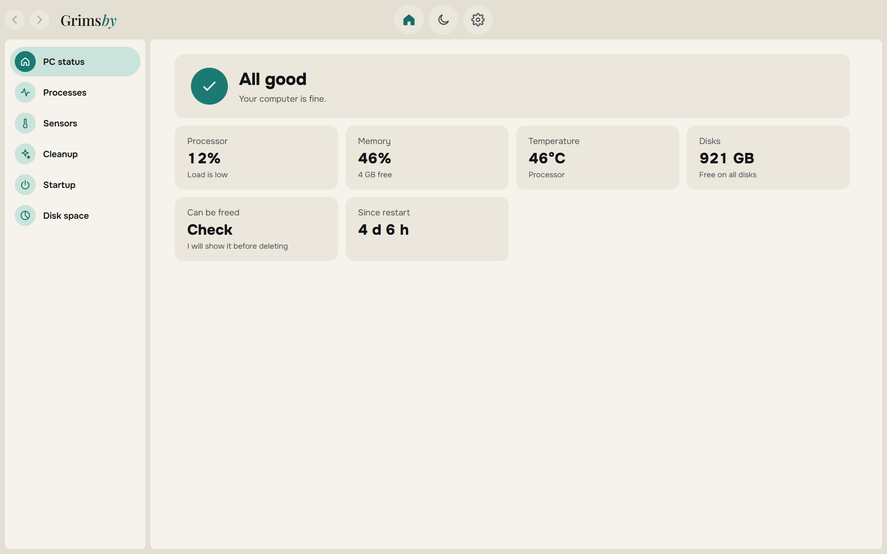

  <b>English</b> ·
  <a href="README.ru.md">Русский</a> ·
  <a href="README.es.md">Español</a> ·
  <a href="README.pt.md">Português</a> ·
  <a href="README.de.md">Deutsch</a> ·
  <a href="README.fr.md">Français</a> ·
  <a href="README.zh.md">中文</a> ·
  <a href="README.ja.md">日本語</a> ·
  <a href="README.ko.md">한국어</a>

  

  <b>Keep your PC healthy — at a glance.</b> 
  See what is loading the computer, how hot it runs and how much space you can free up. Nothing is deleted until you press the button.

  
  
  
  
  

  <a href="https://github.com/maksimkhatskevich/grimsby-helper/releases/latest"><b>⬇ Download for Windows</b></a>
  &nbsp;·&nbsp;
  <a href="#features">Features</a>
  &nbsp;·&nbsp;
  <a href="#privacy">Privacy</a>
  &nbsp;·&nbsp;
  <a href="#feedback">Feedback</a>

---

## Why Grimsby Helper

PC tools usually either show a wall of numbers or promise to “speed up” Windows with one magic button. Neither tells you plainly whether everything is fine.

**Grimsby Helper gives a simple answer.** The home screen says “All good”, “Worth a look” or “There is a problem”, explains why in plain words and shows what to do.

---

## Features

### 🩺 PC status at a glance

A verdict with reasons and a button for what to do. Below it: processor, memory, temperature, free space, how much can be freed and time since the last restart.

### 📈 Processes

Processes and apps with processor, memory, disk, network and graphics load; sorting, search and grouping by app. Clear names and icons, file location and publisher. Charts for processor, memory, disks, network and graphics. **End** and **End tree** ask for confirmation, and system processes are protected.

### 🌡 Sensors and disk health

Processor temperature per core, clock speeds and power draw, graphics cards, disks, fans, motherboard and battery — whatever your PC reports. Disk health: state, SSD wear, power-on time. History for the last hour, day, week or month is kept only on your computer. If a sensor is missing, Helper says so instead of showing zeros.

### 🧹 Cleanup that shows first

Temporary files, browser cache, Recycle Bin, thumbnails, Windows update leftovers, old logs and crash dumps. You see everything found, with sizes and plain descriptions, tick what to remove and see how much will be freed. Files go to the Recycle Bin wherever possible; where they can’t, Helper says so before you press the button. Browser tabs and passwords are never touched.

### 🚀 Startup

What starts with Windows: registry entries, startup folders, scheduled tasks and third-party services. Turn entries off and back on; the publisher is shown, and Microsoft and driver entries are protected from accidental changes.

### 💽 Disk space

A visual map of what takes up space, the largest files and folders. Deleting is manual only, to the Recycle Bin, with confirmation.

### 🔔 Tray and warnings

Closing the window can keep Helper in the tray, with temperature and load in the icon tooltip. Warnings about overheating, low space, low memory or a disk losing health — one event, one notification. Starting with Windows is off by default.

### 🗑 Uninstall completely

First the app’s own uninstaller, then a search for leftovers — folders and registry keys — shown to you before anything is deleted, with a restore point.

### 🧰 Tools

Duplicates, empty folders, broken shortcuts, quick file search, recovery of deleted files, file splitting and joining, a shredder and password encryption. **Privacy:** clear browser history and recent files, wipe free space.

### 🛠 Windows maintenance

System information, disk check, optimization, system file repair, restore points, services, scheduled tasks, context menu and a careful registry cleanup. Processes are split into apps, background and not responding.

### 🤖 On its own, and a journal

Memory cleanup on a schedule, safe automatic cleanup of temporary files and cache, and an offer to close an app that stopped responding. The **Journal** lists everything Helper did by itself or at your click, and system changes can be undone.

### 🔐 Administrator rights

The app itself runs without administrator rights. Reading sensors needs them, so a small separate agent gets them once, with Windows confirmation. Core temperatures, fans and the motherboard also need a sensor driver: Helper downloads its official installer only when you press the button, checks its checksum and installs it with Windows confirmation. You can remove it in Settings. Everything else works without it.

### ⚙️ Settings and your own look

Settings are split into sections — Appearance, Language, Updates and the app’s own — with a search at the top that shows only what matches. Theme: dark, light or as in Windows; the app color: ten ready-made colors or your own. The window background can be a color, a gradient, your own photo or a silent video, with adjustable dimming and blur.

🌍 **9 languages:** English, Russian, Spanish, Portuguese, German, French, Chinese, Japanese and Korean — switch in Settings, it changes right away.

The light theme is one click away — the sun button at the top.

---

## Download and install

1. Open the **[latest release](https://github.com/maksimkhatskevich/grimsby-helper/releases/latest)** page and download the installer `.exe`.
2. Run it. Windows may show a blue "Windows protected your PC" window — that's a normal warning for apps without a paid code-signing certificate. Click **More info → Run anyway**.
   The installer has been checked on VirusTotal: [0 of 68 antivirus engines flag it](https://www.virustotal.com/gui/file/ad42128ab26413ff71df138aab058cc6819f2f707081d396ba444b1f522efc1e) (version 1.1.0).
3. Open Helper — the home screen shows your PC status right away.

**Requirements:** Windows 10 or 11 (64-bit).

---

## Privacy

Grimsby Helper works on your computer. Information about your PC is never sent anywhere. No accounts, no ads, no analytics. The app goes online only to check for updates and, if you press the button, to download the sensor driver.

---

## Grimsby apps

<table>
  <tr>
    <td align="center" width="25%"><a href="https://github.com/maksimkhatskevich/grimsby-releases"> <b>Grimsby Player</b></a> Offline music & video player for your downloaded collection</td>
    <td align="center" width="25%"><a href="https://github.com/maksimkhatskevich/grimsby-converter"> <b>Grimsby Converter</b></a> Video, audio, photos and documents — converted offline</td>
    <td align="center" width="25%"><a href="https://github.com/maksimkhatskevich/grimsby-tagger"> <b>Grimsby Tagger</b></a> Batch tag editor: albums, covers, file names</td>
    <td align="center" width="25%"><a href="https://github.com/maksimkhatskevich/grimsby-prompter"> <b>Grimsby Prompter</b></a> A simple teleprompter that follows your voice</td>
  </tr>
  <tr>
    <td align="center" width="25%"> <b>Grimsby Helper</b> </td>
    <td align="center" width="25%"><a href="https://github.com/maksimkhatskevich/grimsby-studio"> <b>Grimsby Studio</b></a> Video editor with animated music inserts</td>
    <td align="center" width="25%"><a href="https://github.com/maksimkhatskevich/grimsby-notes"> <b>Grimsby Notes</b></a> Tasks, projects, notes and calendar in one window</td>
  </tr>
</table>

---

## Feedback

Found a bug, have an idea or just want to say thanks? Get in touch:

- ✉️ email: **[grimsbyy@gmail.com](mailto:grimsbyy@gmail.com)**
- 🐞 bugs and ideas: [Issues](https://github.com/maksimkhatskevich/grimsby-helper/issues)
- 📣 Telegram: [@itsgrimsby](https://t.me/itsgrimsby) (in Russian)

---

## Licenses

Grimsby Helper uses open-source components, including Electron and React. The full list with license texts is in `THIRD_PARTY_NOTICES.txt` in the program folder.

© 2026 Grimsby

