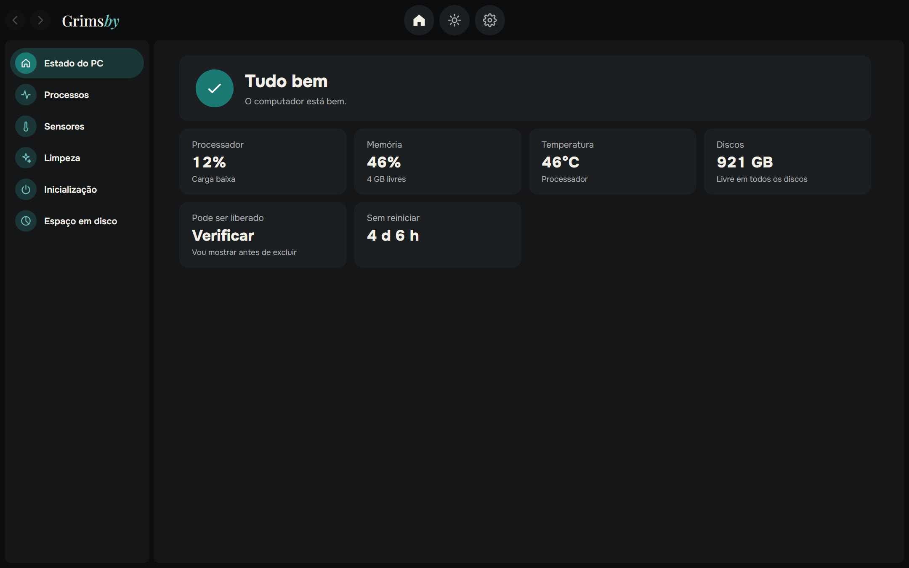
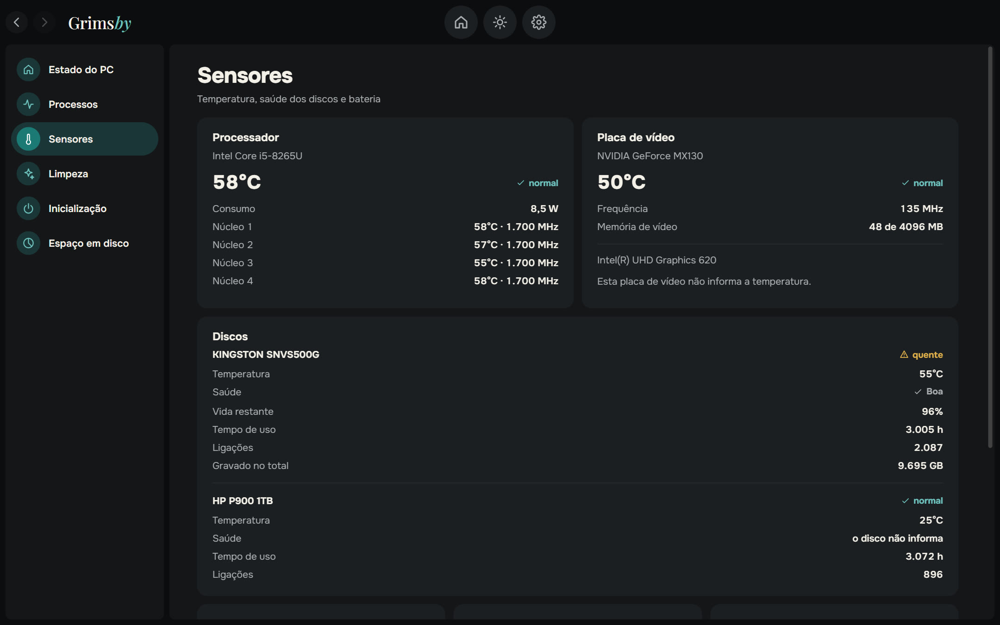
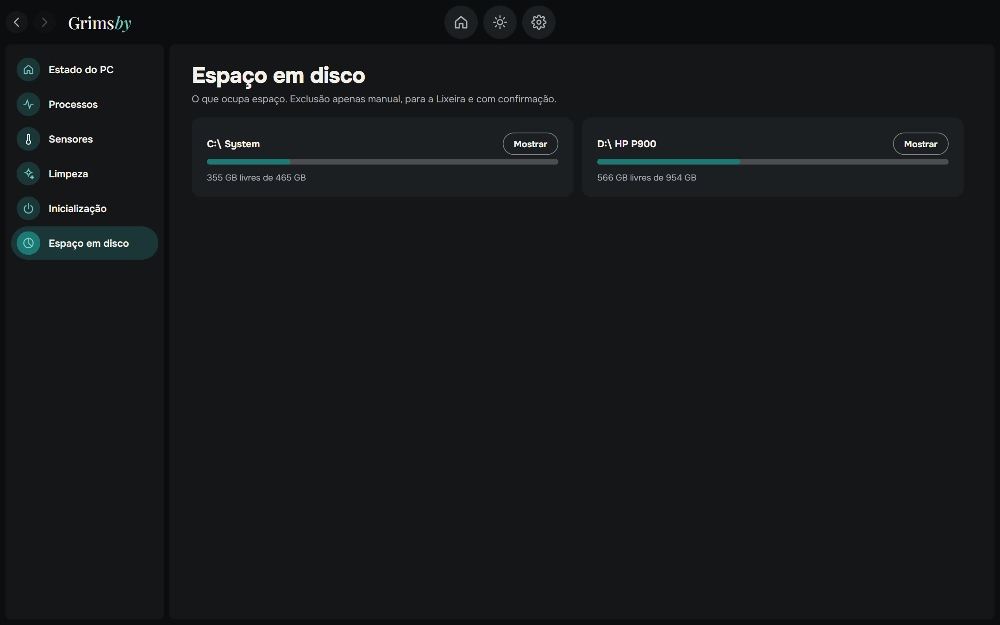
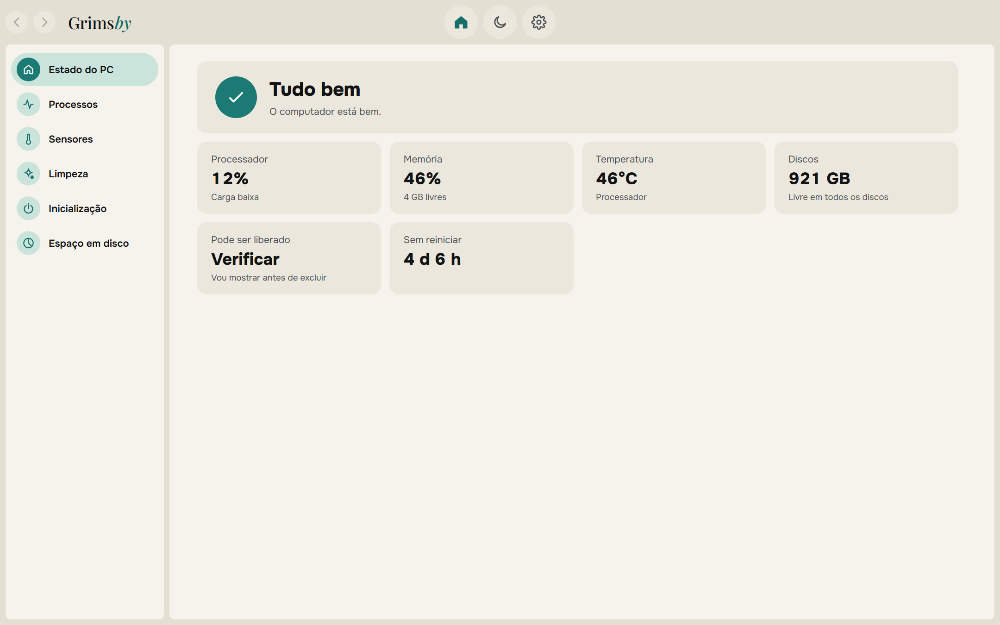

  <a href="README.md">English</a> ·
  <a href="README.ru.md">Русский</a> ·
  <a href="README.es.md">Español</a> ·
  <b>Português</b> ·
  <a href="README.de.md">Deutsch</a> ·
  <a href="README.fr.md">Français</a> ·
  <a href="README.zh.md">中文</a> ·
  <a href="README.ja.md">日本語</a> ·
  <a href="README.ko.md">한국어</a>

  

  <b>A saúde do seu PC, de relance.</b> 
  O que está pesando no computador, quanto ele esquenta e quanto espaço dá para liberar. Nada é apagado até você apertar o botão.

  
  
  
  

  <a href="https://github.com/maksimkhatskevich/grimsby-helper/releases/latest"><b>⬇ Baixar para Windows</b></a>
  &nbsp;·&nbsp;
  <a href="#recursos">Recursos</a>
  &nbsp;·&nbsp;
  <a href="#privacidade">Privacidade</a>
  &nbsp;·&nbsp;
  <a href="#contato">Contato</a>

---

## Por que o Grimsby Helper

Ferramentas para PC costumam mostrar um paredão de números ou prometer “acelerar” o Windows com um botão mágico. Nenhuma das duas coisas diz com clareza se está tudo bem.

**O Grimsby Helper responde de forma simples.** A tela inicial diz “Tudo certo”, “Vale a pena olhar” ou “Há um problema”, explica o motivo em palavras simples e mostra o que fazer.

---

## Recursos

### 🩺 O estado do PC de relance

Uma avaliação com motivos e um botão para o que fazer. Abaixo: processador, memória, temperatura, espaço livre, quanto dá para liberar e tempo desde a última reinicialização.

### 📈 Processos

Processos e apps com carga de processador, memória, disco, rede e placa de vídeo; ordenação, busca e agrupamento por app. Nomes e ícones claros, local do arquivo e editor. Gráficos de processador, memória, discos, rede e placa de vídeo. **Encerrar** e **Encerrar árvore** pedem confirmação, e os processos do sistema são protegidos.

### 🌡 Sensores e saúde dos discos

Temperatura do processador por núcleo, frequências e consumo, placas de vídeo, discos, ventoinhas, placa-mãe e bateria — tudo o que o seu PC informar. Saúde dos discos: estado, desgaste do SSD, horas de uso. O histórico da última hora, dia, semana ou mês fica guardado só no seu computador. Se um sensor não existir, o Helper diz isso em vez de mostrar zeros.

### 🧹 Uma limpeza que mostra antes

Arquivos temporários, cache do navegador, Lixeira, miniaturas, sobras de atualizações do Windows, logs antigos e despejos de falhas. Você vê tudo o que foi encontrado, com tamanhos e descrições simples, marca o que remover e vê quanto será liberado. Os arquivos vão para a Lixeira sempre que possível; quando não dá, o Helper avisa antes de você apertar o botão. Abas e senhas do navegador nunca são tocadas, e não há limpeza de registro.

### 🚀 Inicialização

O que abre com o Windows: entradas do registro, pastas de inicialização, tarefas agendadas e serviços de terceiros. Desative entradas e ative de novo; o editor é mostrado, e as entradas da Microsoft e de drivers são protegidas contra mudanças acidentais.

### 💽 Espaço em disco

Um mapa visual do que ocupa espaço, com os maiores arquivos e pastas. A exclusão é só manual, para a Lixeira e com confirmação.

### 🔔 Bandeja e avisos

Ao fechar a janela, o Helper pode ficar na bandeja, com a temperatura e a carga na dica do ícone. Avisos de superaquecimento, pouco espaço, pouca memória ou de um disco perdendo saúde — um evento, uma notificação. Iniciar com o Windows vem desligado.

### 🔐 Direitos de administrador

O app em si funciona sem direitos de administrador. Para ler os sensores eles são necessários, então um pequeno agente separado os recebe uma vez, com a confirmação do Windows. As temperaturas dos núcleos, as ventoinhas e a placa-mãe precisam também de um driver de sensores: o Helper baixa o instalador oficial só quando você aperta o botão, confere a soma de verificação e instala com a confirmação do Windows. Dá para removê-lo nas Configurações. Todo o resto funciona sem ele.

🌍 **9 idiomas:** inglês, russo, espanhol, português, alemão, francês, chinês, japonês e coreano — troque nas Configurações, muda na hora.

O tema claro fica a um clique — o botão do sol, no alto.

---

## Baixar e instalar

1. Abra a página da **[versão mais recente](https://github.com/maksimkhatskevich/grimsby-helper/releases/latest)** e baixe o instalador `.exe`.
2. Execute-o. O Windows pode mostrar uma janela azul «O Windows protegeu o computador» — é um aviso normal para programas sem certificado de assinatura pago. Clique em **Mais informações → Executar assim mesmo**.
3. Abra o Helper — a tela inicial já mostra o estado do seu PC.

**Requisitos:** Windows 10 ou 11 (64 bits).

---

## Privacidade

O Grimsby Helper funciona no seu computador. As informações do seu PC nunca são enviadas. Sem contas, sem anúncios, sem análises. O app só se conecta para verificar atualizações e, se você apertar o botão, baixar o driver de sensores.

---

## Os apps Grimsby

<table>
  <tr>
    <td align="center" width="20%"><a href="https://github.com/maksimkhatskevich/grimsby-releases/blob/main/README.pt.md"> <b>Grimsby Player</b></a> Player offline para suas músicas e clipes baixados</td>
    <td align="center" width="20%"><a href="https://github.com/maksimkhatskevich/grimsby-converter/blob/main/README.pt.md"> <b>Grimsby Converter</b></a> Vídeo, áudio, fotos e documentos convertidos offline</td>
    <td align="center" width="20%"><a href="https://github.com/maksimkhatskevich/grimsby-tagger/blob/main/README.pt.md"> <b>Grimsby Tagger</b></a> Editor de tags em lote: álbuns, capas, nomes de arquivos</td>
    <td align="center" width="20%"><a href="https://github.com/maksimkhatskevich/grimsby-prompter/blob/main/README.pt.md"> <b>Grimsby Prompter</b></a> Um teleprompter simples que acompanha sua voz</td>
    <td align="center" width="20%"> <b>Grimsby Helper</b> </td>
  </tr>
</table>

---

## Contato

Encontrou um erro, tem uma ideia ou só quer agradecer? Escreva:

- ✉️ e-mail: **[grimsbyy@gmail.com](mailto:grimsbyy@gmail.com)**
- 🐞 erros e ideias: [Issues](https://github.com/maksimkhatskevich/grimsby-helper/issues)
- 📣 Telegram: [@itsgrimsby](https://t.me/itsgrimsby) (em russo)

---

## Licenças

O Grimsby Helper usa componentes de código aberto, entre eles Electron e React. A lista completa com os textos das licenças está em `THIRD_PARTY_NOTICES.txt`, na pasta do programa.

© 2026 Grimsby

