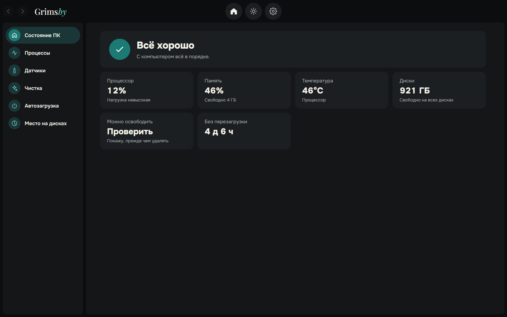
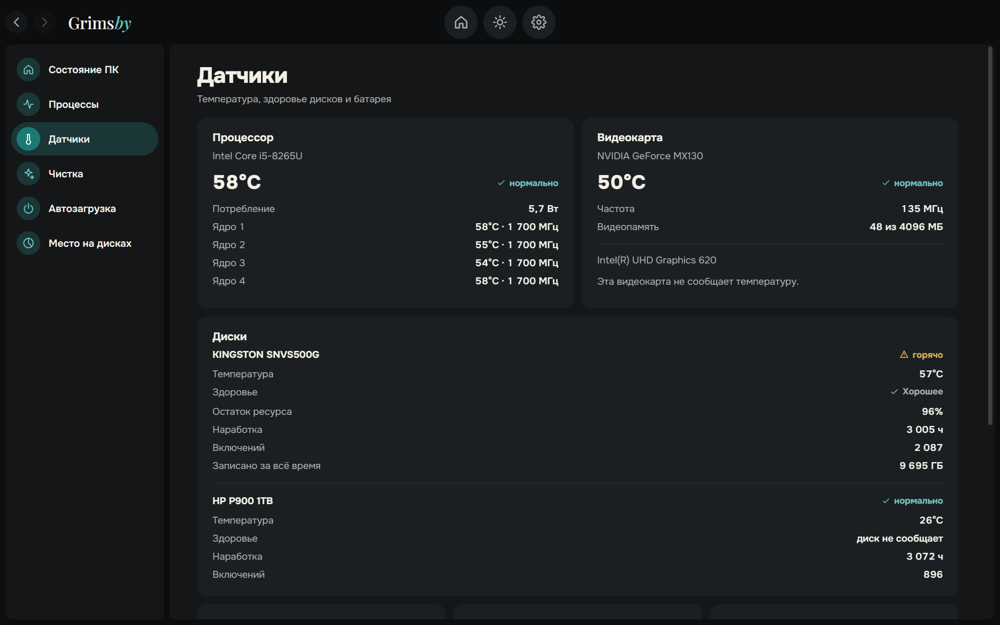
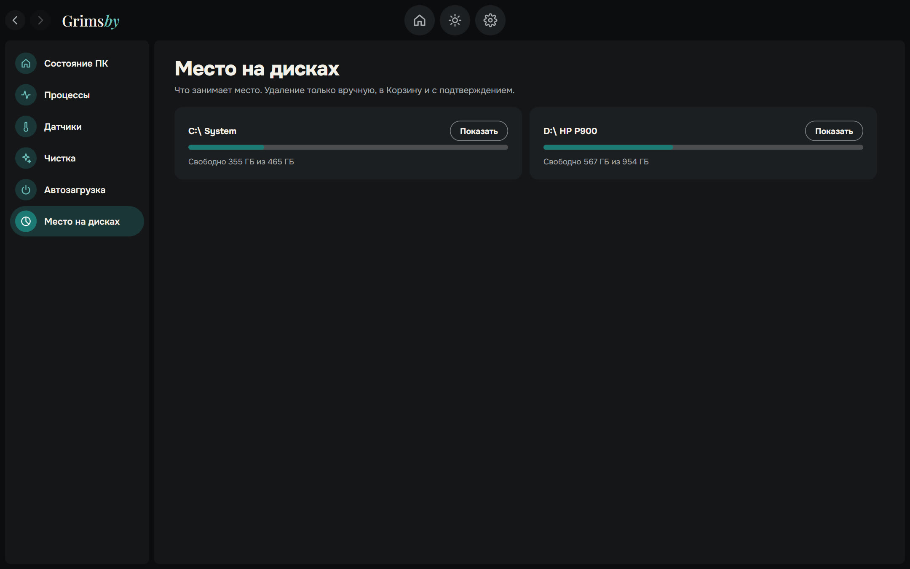
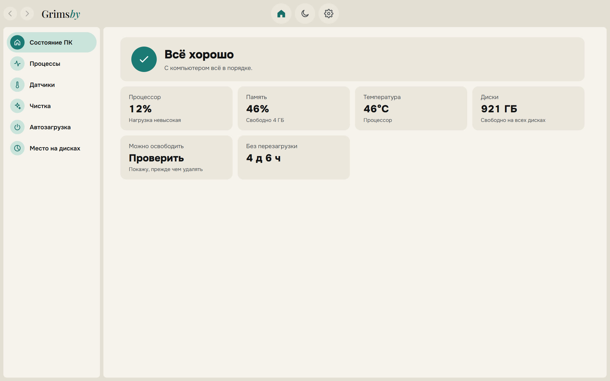

  <a href="README.md">English</a> ·
  <b>Русский</b> ·
  <a href="README.es.md">Español</a> ·
  <a href="README.pt.md">Português</a> ·
  <a href="README.de.md">Deutsch</a> ·
  <a href="README.fr.md">Français</a> ·
  <a href="README.zh.md">中文</a> ·
  <a href="README.ja.md">日本語</a> ·
  <a href="README.ko.md">한국어</a>

  

  <b>Здоровье компьютера — с первого взгляда.</b> 
  Что грузит компьютер, насколько он греется и сколько места можно освободить. Ничего не удаляется, пока вы не нажмёте кнопку.

  
  
  
  
  

  <a href="https://github.com/maksimkhatskevich/grimsby-helper/releases/latest"><b>⬇ Скачать для Windows</b></a>
  &nbsp;·&nbsp;
  <a href="#возможности">Возможности</a>
  &nbsp;·&nbsp;
  <a href="#приватность">Приватность</a>
  &nbsp;·&nbsp;
  <a href="#обратная-связь">Обратная связь</a>

---

## Зачем Grimsby Helper

Программы для ПК обычно либо показывают стену цифр, либо обещают «ускорить» Windows одной волшебной кнопкой. Ни то ни другое не говорит просто, всё ли в порядке.

**Grimsby Helper отвечает просто.** Главная говорит «Всё хорошо», «Стоит обратить внимание» или «Есть проблема», объясняет причину понятными словами и показывает, что сделать.

---

## Возможности

### 🩺 Состояние ПК с первого взгляда

Оценка с причинами и кнопкой, что сделать. Ниже — процессор, память, температура, свободное место, сколько можно освободить и время без перезагрузки.

### 📈 Процессы

Процессы и приложения с нагрузкой на процессор, память, диск, сеть и видеокарту; сортировка, поиск и группировка по приложениям. Понятные имена и значки, расположение файла и издатель. Графики процессора, памяти, дисков, сети и видеокарты. **«Завершить»** и **«Завершить дерево»** спрашивают подтверждение, системные процессы защищены.

### 🌡 Датчики и здоровье дисков

Температура процессора по ядрам, частоты и потребление, видеокарты, диски, вентиляторы, материнская плата и батарея — всё, что сообщает ваш ПК. Здоровье дисков: состояние, износ SSD, наработка. История за час, день, неделю или месяц хранится только на вашем компьютере. Если датчика нет, Helper так и пишет, а не показывает нули.

### 🧹 Чистка, которая сначала показывает

Временные файлы, кэш браузеров, Корзина, эскизы, остатки обновлений Windows, старые журналы и дампы сбоев. Вы видите всё найденное с размерами и понятными описаниями, отмечаете, что удалить, и видите, сколько освободится. Файлы по возможности уходят в Корзину; где это невозможно, Helper скажет об этом до нажатия кнопки. Вкладки и пароли браузеров не трогаются.

### 🚀 Автозагрузка

Что запускается с Windows: записи реестра, папки автозагрузки, задачи планировщика и службы сторонних программ. Отключение и включение обратно; показан издатель, записи Microsoft и драйверов защищены от случайных изменений.

### 💽 Место на дисках

Наглядная карта того, что занимает место, самые большие файлы и папки. Удаление только вручную, в Корзину и с подтверждением.

### 🔔 Трей и предупреждения

При закрытии окна Helper может остаться в трее: в подсказке значка — температура и нагрузка. Предупреждения о перегреве, нехватке места и памяти и о диске, который теряет здоровье: одно событие — одно уведомление. Запуск вместе с Windows по умолчанию выключен.

### 🗑 Удаление программ «под корень»

Сначала штатное удаление, потом поиск остатков — папок и ключей реестра — с показом до удаления и точкой восстановления.

### 🧰 Инструменты

Дубликаты, пустые папки, битые ярлыки, быстрый поиск файлов, восстановление удалённых файлов, разрезание и склейка, шредер и шифрование паролем. **Конфиденциальность:** стирание истории браузеров и недавних файлов, зачистка свободного места.

### 🛠 Обслуживание Windows

Сведения о системе, проверка диска, оптимизация, восстановление системных файлов, точки восстановления, службы, задачи планировщика, контекстное меню и осторожная чистка реестра. Процессы разделены на приложения, фоновые и зависшие.

### 🤖 Сам по себе — и журнал

Очистка памяти по расписанию, безопасная автоочистка временных файлов и кэша, предложение закрыть зависшую программу. В **«Журнале»** — всё, что Helper сделал сам и по вашему нажатию; изменения системы можно отменить.

### 🔐 Права администратора

Сама программа работает без прав администратора. Для чтения датчиков они нужны, поэтому маленький отдельный агент получает их один раз, с подтверждением Windows. Температуре ядер, вентиляторам и материнской плате нужен ещё драйвер датчиков: Helper скачивает его официальный установщик только по вашей кнопке, сверяет контрольную сумму и устанавливает с подтверждением Windows. Удалить его можно в настройках. Всё остальное работает и без него.

### ⚙️ Настройки и своё оформление

Настройки разбиты на разделы — «Оформление», «Язык», «Обновления» и разделы самой программы, — а поиск наверху показывает только то, где нашлось слово. Тема: тёмная, светлая или как в Windows; цвет программы — десять готовых или свой. Фон окна — цвет, градиент, своё фото или видео без звука, с настраиваемым затемнением и размытием.

🌍 **9 языков:** русский, английский, испанский, португальский, немецкий, французский, китайский, японский и корейский — переключаются в настройках сразу.

Светлая тема — в один клик, кнопка с солнцем вверху.

---

## Скачать и установить

1. Откройте страницу **[последней версии](https://github.com/maksimkhatskevich/grimsby-helper/releases/latest)** и скачайте установщик `.exe`.
2. Запустите его. Windows может показать синее окно «Система Windows защитила ваш компьютер» — это обычное предупреждение для программ без платного сертификата подписи. Нажмите **Подробнее → Выполнить в любом случае**.
   Установщик проверен на VirusTotal: [ни один из 68 антивирусов ничего не нашёл](https://www.virustotal.com/gui/file/ad42128ab26413ff71df138aab058cc6819f2f707081d396ba444b1f522efc1e) (версия 1.1.0).
3. Откройте Helper — главная сразу покажет состояние компьютера.

**Требования:** Windows 10 или 11 (64 бит).

---

## Приватность

Grimsby Helper работает на вашем компьютере. Сведения о компьютере никуда не отправляются. Без аккаунтов, рекламы и аналитики. В интернет программа выходит, только чтобы проверить обновления и, если вы нажмёте кнопку, скачать драйвер датчиков.

---

## Программы Grimsby

<table>
  <tr>
    <td align="center" width="25%"><a href="https://github.com/maksimkhatskevich/grimsby-releases/blob/main/README.ru.md"> <b>Grimsby Player</b></a> Офлайн-плеер для скачанной музыки и клипов</td>
    <td align="center" width="25%"><a href="https://github.com/maksimkhatskevich/grimsby-converter/blob/main/README.ru.md"> <b>Grimsby Converter</b></a> Видео, аудио, фото и документы — конвертация без интернета</td>
    <td align="center" width="25%"><a href="https://github.com/maksimkhatskevich/grimsby-tagger/blob/main/README.ru.md"> <b>Grimsby Tagger</b></a> Пакетный редактор тегов: альбомы, обложки, имена файлов</td>
    <td align="center" width="25%"><a href="https://github.com/maksimkhatskevich/grimsby-prompter/blob/main/README.ru.md"> <b>Grimsby Prompter</b></a> Простой телесуфлёр, который следует за голосом</td>
  </tr>
  <tr>
    <td align="center" width="25%"> <b>Grimsby Helper</b> </td>
    <td align="center" width="25%"><a href="https://github.com/maksimkhatskevich/grimsby-studio/blob/main/README.ru.md"> <b>Grimsby Studio</b></a> Видеоредактор с анимированными музыкальными вставками</td>
    <td align="center" width="25%"><a href="https://github.com/maksimkhatskevich/grimsby-notes/blob/main/README.ru.md"> <b>Grimsby Notes</b></a> Задачи, проекты, заметки и календарь в одном окне</td>
  </tr>
</table>

---

## Обратная связь

Нашли ошибку, есть идея или просто хотите сказать спасибо? Пишите:

- ✉️ почта: **[grimsbyy@gmail.com](mailto:grimsbyy@gmail.com)**
- 🐞 ошибки и идеи: [Issues](https://github.com/maksimkhatskevich/grimsby-helper/issues)
- 📣 Telegram: [@itsgrimsby](https://t.me/itsgrimsby)

---

## Лицензии

Grimsby Helper использует компоненты с открытым кодом, в том числе Electron и React. Полный список с текстами лицензий — в файле `THIRD_PARTY_NOTICES.txt` в папке программы.

© 2026 Grimsby

