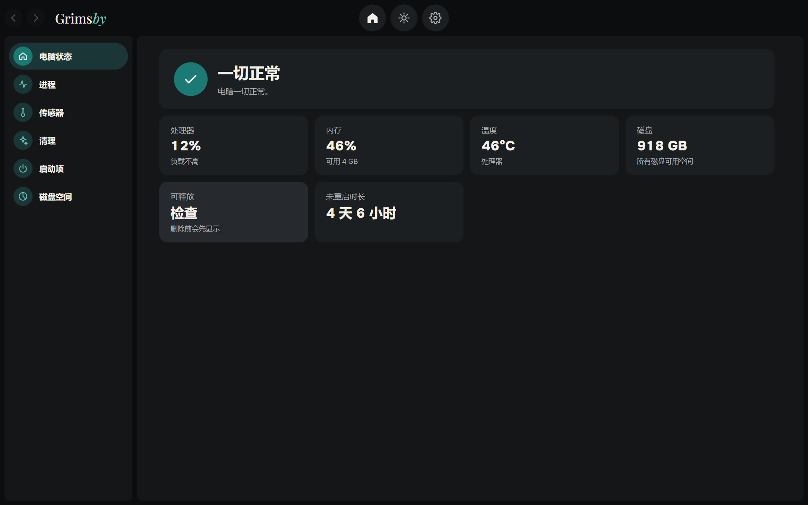
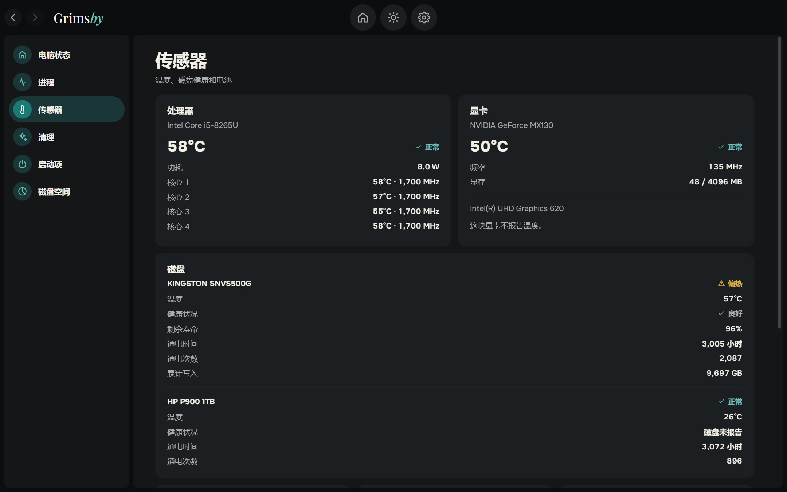
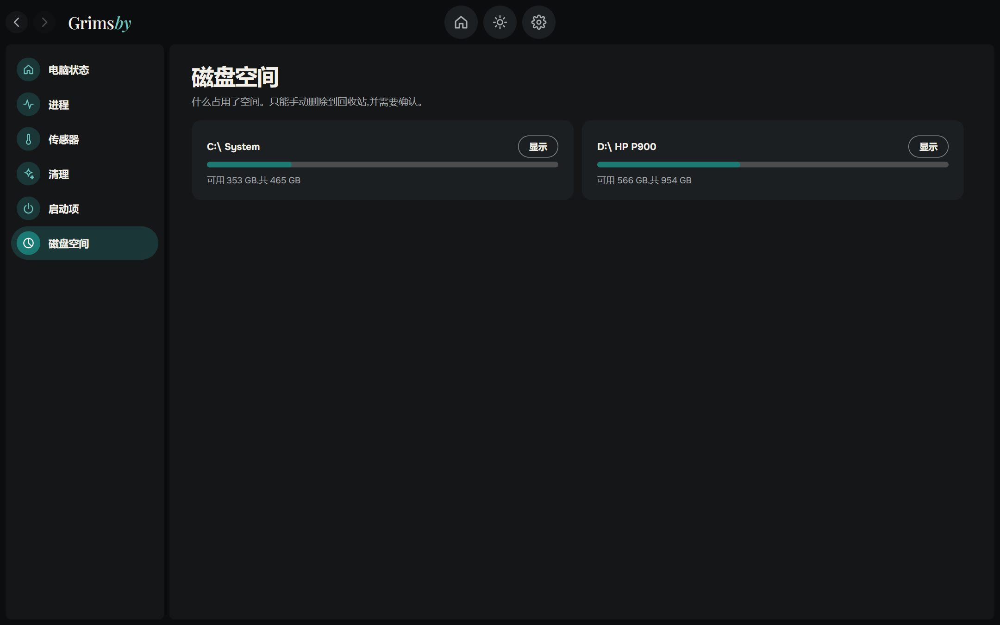
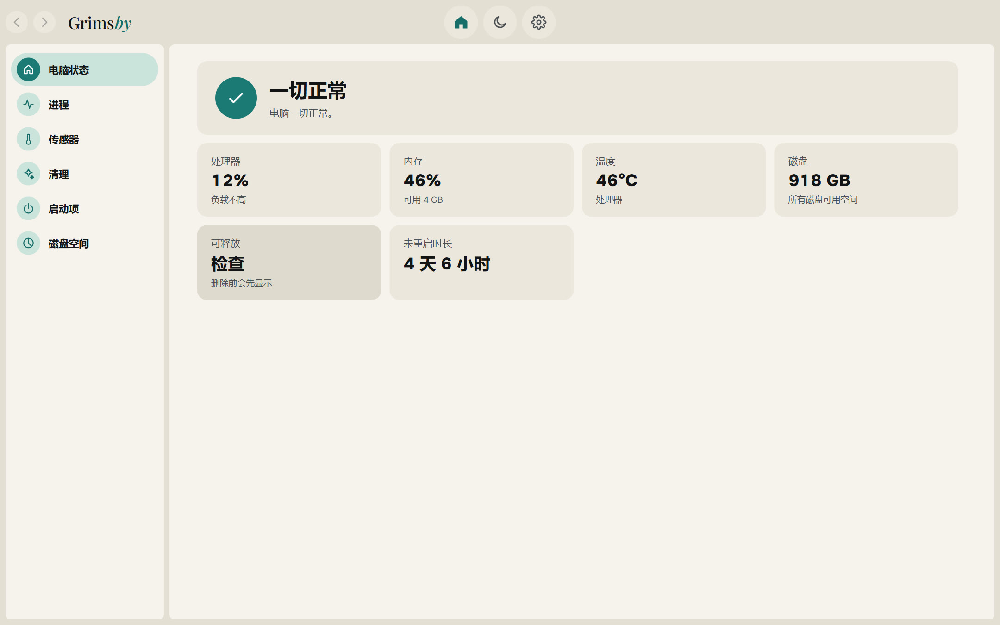

  <a href="README.md">English</a> ·
  <a href="README.ru.md">Русский</a> ·
  <a href="README.es.md">Español</a> ·
  <a href="README.pt.md">Português</a> ·
  <a href="README.de.md">Deutsch</a> ·
  <a href="README.fr.md">Français</a> ·
  <b>中文</b> ·
  <a href="README.ja.md">日本語</a> ·
  <a href="README.ko.md">한국어</a>

  

  <b>电脑是否健康，一眼就知道。</b> 
  看看是什么在占用电脑、温度有多高、能释放多少空间。只有你按下按钮，才会删除任何东西。

  
  
  
  
  

  <a href="https://github.com/maksimkhatskevich/grimsby-helper/releases/latest"><b>⬇ 下载 Windows 版</b></a>
  &nbsp;·&nbsp;
  <a href="#功能">功能</a>
  &nbsp;·&nbsp;
  <a href="#隐私">隐私</a>
  &nbsp;·&nbsp;
  <a href="#反馈">反馈</a>

---

## 为什么选择 Grimsby Helper

电脑工具通常要么给你一大堆数字，要么承诺用一个神奇按钮“加速” Windows。两者都没有直白地告诉你：一切是否正常。

**Grimsby Helper 给出简单的答案。** 主页会显示“一切正常”“值得关注”或“有问题”，用通俗的话说明原因，并告诉你该怎么做。

---

## 功能

### 🩺 电脑状态一目了然

带原因的评价，以及一个“该怎么做”的按钮。下方是处理器、内存、温度、可用空间、可释放空间和距上次重启的时间。

### 📈 进程

进程和应用的处理器、内存、磁盘、网络和显卡占用；支持排序、搜索和按应用分组。清晰的名称和图标、文件位置和发布者。处理器、内存、磁盘、网络和显卡图表。**结束** 和 **结束进程树** 会先确认，系统进程受到保护。

### 🌡 传感器与磁盘健康

按核心显示的处理器温度、频率和功耗，显卡、磁盘、风扇、主板和电池——只要你的电脑提供就会显示。磁盘健康：状态、SSD 磨损、通电时间。最近一小时、一天、一周或一个月的历史只保存在你的电脑上。没有某个传感器时，Helper 会直接说明，而不是显示零。

### 🧹 先展示再清理

临时文件、浏览器缓存、回收站、缩略图、Windows 更新残留、旧日志和崩溃转储。你能看到找到的所有内容、大小和通俗说明，勾选要删除的项目并看到能释放多少空间。文件尽量移入回收站；无法移入时，Helper 会在你点击前说明。浏览器标签页和密码绝不触碰。

### 🚀 开机启动

随 Windows 启动的项目：注册表项、启动文件夹、计划任务和第三方服务。可以停用并重新启用；显示发布者，Microsoft 和驱动程序的项目受到保护，避免误改。

### 💽 磁盘空间

直观的空间占用地图，以及最大的文件和文件夹。只能手动删除，删除到回收站，并需确认。

### 🔔 托盘与提醒

关闭窗口后 Helper 可以留在托盘，图标提示中显示温度和负载。在过热、空间不足、内存不足或磁盘健康下降时提醒——一个事件，一条通知。随 Windows 启动默认关闭。

### 🗑 彻底卸载

先运行程序自带的卸载程序，再查找残留的文件夹和注册表项，删除前会先展示给你，并创建还原点。

### 🧰 工具

重复文件、空文件夹、失效快捷方式、快速文件搜索、恢复已删除文件、文件分割与合并、粉碎机和密码加密。**隐私：** 清除浏览器历史和最近使用的文件，擦除可用空间。

### 🛠 Windows 维护

系统信息、磁盘检查、优化、修复系统文件、还原点、服务、计划任务、右键菜单以及谨慎的注册表清理。进程分为应用、后台和无响应三类。

### 🤖 自动处理与日志

定时清理内存，安全地自动清理临时文件和缓存，并在程序无响应时建议关闭。**日志** 记录 Helper 自动或按你的点击所做的一切，系统更改可以撤销。

### 🔐 管理员权限

程序本身无需管理员权限即可运行。读取传感器需要管理员权限，因此一个独立的小代理会在 Windows 确认后获得一次权限。核心温度、风扇和主板还需要传感器驱动：只有你按下按钮，Helper 才会下载官方安装程序、校验其校验和，并在 Windows 确认后安装。可在设置中卸载。其他功能不依赖它。

### ⚙️ 设置与个性外观

设置分为多个分区——外观、语言、更新以及软件自己的分区，顶部的搜索只显示匹配的内容。主题可选深色、浅色或跟随 Windows；软件颜色有十种现成的，也可以自定义。 窗口背景可以是纯色、渐变、你自己的照片或无声视频，并可调节暗化和模糊。

🌍 **9 种语言：** 英语、俄语、西班牙语、葡萄牙语、德语、法语、中文、日语和韩语——在设置中切换，立即生效。

浅色主题一键切换——顶部的太阳按钮。

---

## 下载与安装

1. 打开 **[最新版本](https://github.com/maksimkhatskevich/grimsby-helper/releases/latest)** 页面，下载安装程序 `.exe`。
2. 运行它。Windows 可能会显示蓝色的“Windows 已保护你的电脑”窗口——这是没有付费代码签名证书的程序的正常提示。点击 **更多信息 → 仍要运行**。
   安装程序已在 VirusTotal 上检测：[68 款杀毒引擎均未发现问题](https://www.virustotal.com/gui/file/ad42128ab26413ff71df138aab058cc6819f2f707081d396ba444b1f522efc1e)（1.1.0 版）。
3. 打开 Helper——主页会立即显示电脑状态。

**系统要求：** Windows 10 或 11（64 位）。

---

## 隐私

Grimsby Helper 在你的电脑上运行。电脑信息绝不会发送到任何地方。无需账号，没有广告，没有统计。程序只会在检查更新时联网，以及在你按下按钮时下载传感器驱动。

---

## Grimsby 应用

<table>
  <tr>
    <td align="center" width="25%"><a href="https://github.com/maksimkhatskevich/grimsby-releases/blob/main/README.zh.md"> <b>Grimsby Player</b></a> 为你下载的音乐和 MV 打造的离线播放器</td>
    <td align="center" width="25%"><a href="https://github.com/maksimkhatskevich/grimsby-converter/blob/main/README.zh.md"> <b>Grimsby Converter</b></a> 视频、音频、照片和文档，离线转换</td>
    <td align="center" width="25%"><a href="https://github.com/maksimkhatskevich/grimsby-tagger/blob/main/README.zh.md"> <b>Grimsby Tagger</b></a> 批量标签编辑：专辑、封面、文件名</td>
    <td align="center" width="25%"><a href="https://github.com/maksimkhatskevich/grimsby-prompter/blob/main/README.zh.md"> <b>Grimsby Prompter</b></a> 会跟随你声音的简单提词器</td>
  </tr>
  <tr>
    <td align="center" width="25%"> <b>Grimsby Helper</b> </td>
    <td align="center" width="25%"><a href="https://github.com/maksimkhatskevich/grimsby-studio/blob/main/README.zh.md"> <b>Grimsby Studio</b></a> 带动画音乐插段的视频编辑器</td>
    <td align="center" width="25%"><a href="https://github.com/maksimkhatskevich/grimsby-notes/blob/main/README.zh.md"> <b>Grimsby Notes</b></a> 任务、项目、笔记和日历，一个窗口全搞定</td>
  </tr>
</table>

---

## 反馈

发现了问题、有想法，或者只是想说声谢谢？欢迎联系：

- ✉️ 邮箱: **[grimsbyy@gmail.com](mailto:grimsbyy@gmail.com)**
- 🐞 问题与建议: [Issues](https://github.com/maksimkhatskevich/grimsby-helper/issues)
- 📣 Telegram：[@itsgrimsby](https://t.me/itsgrimsby)（俄语）

---

## 许可证

Grimsby Helper 使用了开源组件，包括 Electron 和 React。完整列表及许可证文本见程序文件夹中的 `THIRD_PARTY_NOTICES.txt`。

© 2026 Grimsby

